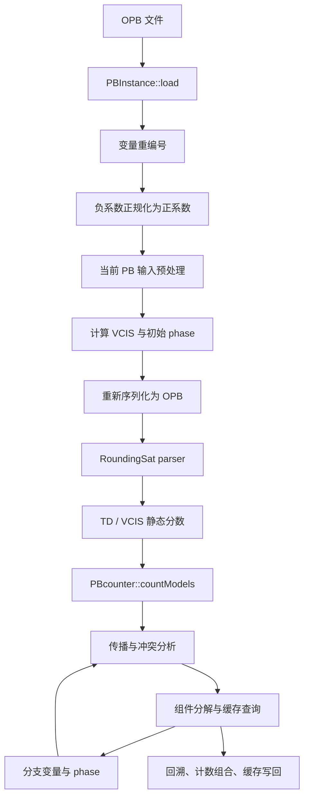
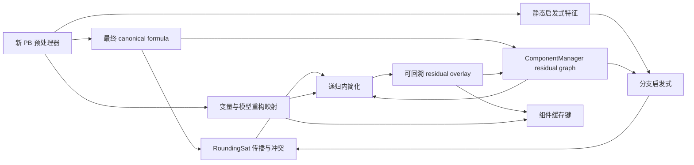

# PBMC 代码框架与四个改进模块开发指南

> 适用代码基线：当前仓库提交 `08eb389`。文中的行号用于帮助第一次定位；以后代码变化时，应以函数名和类型名为准。
>
> 本文聚焦四项后续工作：递归内简化、新 PB 预处理器、VCIS/新启发式、组件缓存更新。它不是只列文件名，而是说明这些模块怎样共同维护精确计数语义。

> 当前学习与改进范围限定为 `-mode=0`：统计全部原始布尔变量上的精确模型数。本文后续的公式、数据结构建议和测试标准都以这一模式为准。

与简化技术直接相关的数学规则、负文字与等式、PB 传播/reason/冲突学习、计数安全矩阵和外部技术迁移模板，请配合专项文档 [PBMC 无权精确模型计数简化技术与冲突学习指南](PBMC_SIMPLIFICATION.md) 阅读。本文保留为总体架构导航，专项文档用于逐条评审和实现具体简化技术。

阅读建议：第一次先读第 0～4 节建立全局流程；准备实现哪一块，就读第 5、6、7 或 8 节；动手前再读第 9～12 节的依赖、路线和测试；第 13～16 节用作日常定位手册。

## 0. 先记住四个结论

1. PBMC 没有用 C++ 函数递归实现主搜索。`PBcounter::count_main()` 用 RoundingSat 的赋值栈、`Decision` 栈和 `Component` 栈模拟递归。以后说“每次递归执行简化”，实际是指搜索状态机每次进入一个节点时执行简化。
2. 在 PBInstance 层，当前唯一显式的全公式预处理循环是 `PBInstance::simplifyRenumberedConstraint()`。随后 RoundingSat 仍会对每条输入执行 `postProcess()` 和根传播；`PPMC::Preprocessor` 是从 GPMC 保留的 CNF 预处理器，`PBcounter::preprocess()` 没有被主程序调用，搜索内的 `PBcounter::simplify()` 目前只是空壳。
3. 新的递归简化应优先放在“RoundingSat 传播到不动点之后、`splitComponent()` 分解和缓存查询之前”。这时简化才能暴露新的分解机会，而且缓存键不会早于简化结果生成。
4. SAT 等价不等于无权精确 MC 等价。任何变量消除、替换、自由变量处理都必须考虑完整模型扩展数、缓存值和回溯恢复；否则公式仍然可满足，不代表完整模型数仍然正确。

建议第一阶段只做“产生新蕴含赋值、检测冲突、标记冗余约束”的可回溯简化。变量替换与变量消除放到计数修正、映射重构和新缓存键都完成以后。

---

## 1. 整体架构

PBMC 由三类核心能力组合而成：

- PBMC/GPMC 框架：top-down 精确计数、组件分解和组件缓存；
- RoundingSat：PB 约束表示、watch propagation、冲突分析、学习和回跳；
- FlowCutter/树分解模块：为分支变量提供静态结构分数。

主流程如下：



对应的真实调用链是：

```text
main()
└─ main_pbmc()                                      core/Main.cc:201
   ├─ PBcounter::load()
   │  └─ PBInstance::load()                         core/Instance.cc:420
   ├─ PBInstance::renumberVar()                     core/Instance.cc:850
   ├─ PBInstance::makeRenumberedCoeffPositive()     core/Instance.cc:1016
   ├─ PBInstance::simplifyRenumberedConstraint()    core/Instance.cc:1051
   ├─ PBInstance::computeVarCoeffScore()            core/Instance.cc:903
   ├─ PBInstance::getRenumberedOpb()                core/Instance.cc:790
   ├─ rs::parsing::file_read()                      roundingsat/parsing.cpp
   ├─ PBcounter::setExtraVarScore()                 core/Counter.cc:1361
   └─ PBcounter::countModels()                      core/Counter.cc:374
      ├─ PBcounter::import()
      ├─ ComponentManager::init()                   core/ComponentManager.cc:84
      └─ PBcounter::count_main()                    core/Counter.cc:394
```

### 1.1 目录角色

| 目录/文件 | 当前角色 | 以后主要改动关系 |
|---|---|---|
| `core/Main.cc` | 参数解析后的主入口、输入到计数的编排 | 接入新预处理器配置和结果 |
| `core/Instance.*` | OPB 轻量解析、重编号、输入预处理、VCIS | 新静态 PB 预处理器、静态特征 |
| `core/Counter.*` | 计数主状态机、冲突/回溯协调、启发式入口 | 递归简化的主要调度点 |
| `core/Component.*` | 决策、组件、packed key、缓存和管理器类型 | undo marker、缓存键/载荷扩展 |
| `core/ComponentManager.cc` | 剩余图分解、gap、动态频率、选变量 | 让递归简化影响分解与动态启发式 |
| `core/ComponentCache.cc` | 哈希查询、内存限制和淘汰 | 新缓存策略、健壮性修复 |
| `core/Config.*` | PBMC/GPMC 选项 | 拆开 TD、VCIS、简化规则和缓存选项 |
| `core/pbconstraint.h` | 输入层的轻量 PB 约束 | 新预处理 IR；当前 `Int=long` 是限制 |
| `roundingsat/` | 实际 PB solver 内核 | 传播 reason、可逆约束状态、冲突接口 |
| `preprocessor/Preprocessor.*` | 未接入 PBMC 的 CNF 预处理器 | 只能参考架构，不能直接处理 PB |
| `preprocessor/TreeDecomposition.*` | primal graph、TD 和 centroid 分数 | 静态结构启发式 |
| `preprocessor/IFlowCutter.*` | FlowCutter 封装 | TD 构造 |
| `flow-cutter-pace17/` | 第三方树分解实现 | 通常不改 |
| `ddnnf/` | 可选 d-DNNF 节点构造与输出 | 结构简化时也要维护证明节点 |
| `mtl/`、`utils/`、`mpfr/` | 容器、选项/系统工具、实数类型 | 基础依赖，通常不改算法 |

`core/` 和 `roundingsat/` 是当前真正参与编译的完整源码。`pbmc-mod/`、`roundingsat-mod/` 是 setup 流程使用的修改层；如果将来仍会重新运行 setup，完成且验证过的修改也要同步到对应 mod 目录。

---

## 2. 必须先统一的表示与编号

这个项目同时使用 PBInstance、RoundingSat 和 Glucose/GPMC 三套表示。后续四个模块都会跨越它们，最容易出错的是下标和文字极性。

### 2.1 三套编号

| 所在模块 | 变量/文字表示 | 示例 |
|---|---|---|
| OPB、`PBconstraint` | 有符号、1-based | `3` 是 `x3`，`-3` 是 `~x3` |
| RoundingSat `rs::Var/rs::Lit` | 有符号、1-based，`0` 无效 | `+3/-3` |
| `Component`、Glucose `Var`、`assigns`、`exscore` | 变量 0-based | RoundingSat 的变量 3 对应 Component 变量 2 |

核心映射：

```text
component_var = rs_var - 1
rs_var        = component_var + 1
```

目前这类 `+1/-1` 分散在很多函数里。新增模块前，建议先提供集中转换 helper 或强类型，例如 `RsVar1`、`CompVar0`，不要让每条简化规则自行换算。

### 2.2 `PBconstraint`

定义在 `core/pbconstraint.h`：

```cpp
struct PBconstraint {
    vector<Int> lits;
    vector<Int> coeffs;
    Int rhs;
    bool equals;
    Int constraintId;
};
```

含义是：

```text
coeffs[0] * lits[0] + ... + coeffs[n-1] * lits[n-1] >= rhs
```

或在 `equals=true` 时使用 `=`。它只是输入/预处理层表示；进入搜索后，约束由 RoundingSat 的 `Constr`、`ConstrExp`、`CRef` 和 `ConstraintAllocator` 管理。

当前 `using Int = long`，所以即使 RoundingSat 内部支持大整数，输入仍先经过机器整数和 `stol`。新预处理器若要正确支持大系数，应统一到 RoundingSat 的大整数类型或另一种任意精度类型。

### 2.4 RoundingSat 搜索状态

`roundingsat/Solver.hpp` 中最重要的成员是：

| 状态 | 含义 |
|---|---|
| `trail` | 当前赋值文字，按产生顺序排列 |
| `trail_lim` | 每个决策层在 `trail` 的起始位置 |
| `Pos[v]` | 变量在 `trail` 中的位置，未赋值为 `INF` |
| `Level[l]` | 文字所在决策层 |
| `Reason[v]` | 推导该变量的 PB 约束 |
| `qhead` | 已传播到 `trail` 的位置 |
| `adj` | watched constraints |
| `phase[v]` | 当前推荐分支文字，后续会被 phase saving 更新 |
| `activity[v]` | RoundingSat 冲突活跃度，使用 1-based 变量 |

`PBcounter::assigns` 只是同步给 ComponentManager 的 0-based 镜像。新简化器绝不能只修改 `assigns`；那不会更新 RoundingSat 的 watch、reason、冲突分析和回溯状态。

### 2.5 核心对象的所有权关系

`PBcounter<T_data>` 继承 `rs::Solver`，所以一个计数器对象同时持有求解器状态和计数器状态：

```text
PBcounter<T_data> : rs::Solver
├─ 从 rs::Solver 继承
│  ├─ ca / constraints          RoundingSat 约束库
│  ├─ trail / trail_lim         赋值与决策层
│  ├─ Pos / Level / Reason      传播与冲突分析
│  ├─ adj / qhead               watch propagation
│  ├─ phase / activity          求解器启发式状态
│  └─ learnedStack              待处理学习约束
│
├─ pbins                        PBInstance，输入/静态预处理表示
├─ cmpmgr                       ComponentManager，分解/缓存/显式递归
├─ assigns                      给 cmpmgr 的 0-based 赋值镜像
├─ exscore                      当前全局静态额外分数
├─ unitcls                      遗留容器，当前只读/清空、未找到写入路径
├─ limlevel                     计数组件的受限回跳边界
└─ pp                           未实际接入的 CNF Preprocessor
```

RoundingSat 的约束引用也要区分：

| 类型 | 含义 |
|---|---|
| `rs::CRef` | `ConstraintAllocator` 中一个紧凑约束的位置引用 |
| `rs::Constr` | allocator 内用于高效传播的多态约束 |
| `rs::CeSuper` | 可展开、可变换、可用于冲突分析的约束表达对象 |
| `rs::ID` | 约束的逻辑/证明 ID，不等同于 `CRef` 偏移 |

ComponentManager 又有自己的 `pbca_` 和 `constraints_`；这里的 `CRef` 只能在对应 allocator 中解释，不能把 solver `ca` 的引用直接拿去索引 `pbca_`。

---

## 3. 启动、输入正规化与当前预处理

### 3.1 主程序中的顺序

`main_pbmc()` 当前严格按以下顺序执行：

1. `PBInstance::load()` 解析原始 OPB；
2. `renumberVar()` 完成当前输入变量的内部重编号；
3. `makeRenumberedCoeffPositive()` 把所有系数改写为正数；
4. `simplifyRenumberedConstraint()` 做当前 PB 输入预处理；
5. 在简化后的 `renumberedClauses` 上计算 VCIS 和初始 phase；
6. `getRenumberedOpb()` 再生成一份内存中的 OPB；
7. RoundingSat parser 再解析，创建真正用于传播和冲突分析的约束；
8. 计算 TD/VCIS 额外分数；
9. 进入计数搜索。

这意味着当前公式存在两份不同生命期的表示：

```text
PBInstance/PBconstraint          RoundingSat/Constr
输入和静态预处理阶段       →      搜索和传播阶段
```

以后不能在搜索中直接调用 `PBInstance::simplifyRenumberedConstraint()`，因为它不认识 RoundingSat watch、trail、reason、组件栈和回溯。

### 3.2 正系数正规化

对于负系数项：

```text
-a*x = a*(1-x)-a = a*~x-a
```

所以：

```text
-3 x + 2 y >= 4
```

可改写为：

```text
3 ~x + 2 y >= 7
```

`getPositiveCoeffRenumberedConstraint()` 会翻转文字、修正 RHS，然后按系数降序排序。降序不变量不只服务输入预处理，也被 RoundingSat 和缓存 gap saturation 依赖；后续新规则改写约束后必须重新 canonicalize。

### 3.3 当前输入预处理做了什么

`PBInstance::simplifyRenumberedConstraint()` 循环到不动点：

```text
检查单文字/空/恒真约束
          ↓
记录固定赋值
          ↓
把赋值代入其他约束并更新 RHS
          ↓
对二元约束做局部 probing
          ↓
有变化则重新开始
```

具体规则：

- 单文字 `>=` 或 `=` 约束推导固定赋值或发现矛盾；
- 空等式且 `rhs != 0` 为冲突；
- 空 `>=` 且 `rhs > 0` 为冲突；
- 正系数 `>=` 约束在 `rhs <= 0` 时恒真并删除；
- 已满足文字从 RHS 中减去系数，已 falsify 的文字只被删除；
- probing 只针对二元 PB 约束，不是调用完整 PB solver 的 failed-literal propagation。

推导赋值并没有删除变量。`getRenumberedOpb()` 把它们重新追加成单位 PB 约束：

```opb
1 x3 >= 1 ;
1 ~x7 >= 1 ;
```

因此固定变量只保留一个可能赋值，模型数仍可保持。

### 3.4 三套容易混淆的“预处理/简化”

| 名称 | 当前是否生效 | 说明 |
|---|---:|---|
| `PBInstance::simplifyRenumberedConstraint()` | 是 | PBInstance 层当前的全公式 PB 输入预处理循环 |
| `PBcounter::preprocess()` | 否 | 主程序没有调用，只处理少量状态/输出 |
| `PPMC::Preprocessor<T>` | 否 | 接口接收 `Instance<T>*`，处理 CNF clause，不接受 `PBInstance<T>*` |
| `PBcounter::simplify()` | 调用接口存在，但实际为空 | 直接 `return true`，没有执行递归内简化 |

`PPMC::Preprocessor` 中的 failed literal、strengthening、equivalence elimination、variable elimination、subsumption 可以作为组织方式参考，但不能把 CNF 代码直接接到 PB 约束上。

RoundingSat 并非原样接收这些约束：`addInputConstraint()` 还会调用 `postProcess()` 完成逐约束去 unit/零项、saturation、GCD、cardinality detection，并调用 `runPropagation(true)` 做根传播。这些属于后端规范化与传播，不应和 PBInstance 的全公式预处理循环混为一谈。

### 3.5 当前预处理需要先测试的风险

以下是代码审计项，不应在没有测试时一次性混入算法改造：

1. `inferAssignment()`/`inferProbe()` 使用 `double rhs/coefficient` 判断整数关系；大整数时应改为精确比较。
2. failed-probe 的某条路径修改 `this->inferredAssignment`，外层最后又用局部 `currentInferredAssignment` 覆盖它，推导结果可能丢失。
3. `Main.cc` 中 `bool preprocess = true` 是硬编码；`ConfigCounter::doPreprocss` 没有真正控制它。
4. 重新输出 OPB 时，头部约束数不包含后来追加的固定赋值单位约束；当前 parser 不依赖该数字，但新实现应保持一致。
5. 预处理判断 UNSAT 后当前路径使用 `exit(1)`，而不是正常输出精确计数 0；以后应统一为正常求解结果。
6. 等式在 PBInstance 中是一条记录，RoundingSat parser 会转换成两个不等式；静态特征和实际搜索公式可能因此不完全一致。

---

## 4. `count_main()`：PBMC 的显式递归状态机

### 4.1 三棵相互对齐的栈

PBMC 用以下状态共同模拟递归：

```text
RoundingSat trail / trail_lim
        │ 当前变量赋值与决策层
        ▼
ComponentManager::dl_        vector<Decision<T_data>>
        │ 两个分支、当前分量区间和局部模型数
        ▼
ComponentManager::comp_stack_
          当前/待处理的独立 Component
```

新增递归简化后，还需要第四条与它们对齐的状态：

```text
Simplification undo trail + 每层 marker
```

### 4.2 `Decision<T_data>`：加法和乘法在哪里发生

定义在 `core/Component.h:33`。重要字段：

| 字段 | 含义 |
|---|---|
| `cur_branch_` | 当前是第一个还是第二个布尔分支 |
| `basecomp_` | 本决策的父 Component 在组件栈中的位置 |
| `splitcompFrom_/End_` | 当前分支产生的待处理子组件区间 |
| `models_[2]` | 两个分支各自的计数 |
| `hasmodel_[2]` | 分支是否存在模型，不能仅靠数值是否为 0 判断 |

两个布尔分支相加：

```cpp
totalModels() = models_[0] + models_[1];
```

同一分支的独立组件相乘：

```cpp
increaseModels(child_count);
```

第一次设置当前分支计数，后续调用才做乘法。`hasmodel_` 显式记录分支是否已经得到模型，避免把“尚未计算”和“精确计数为 0”混为一谈。

### 4.3 每轮主循环

当前 `count_main()` 的实际顺序：

```text
遍历遗留 unitcls
（当前无写入路径，通常为空；若非空则使用 decide）
      ↓
RoundingSat propagation
      ├─ 冲突
      │   ├─ PB 冲突分析
      │   ├─ 生成候选学习约束
      │   ├─ 非顺序回跳，或当前分支记 0
      │   └─ 清理被放弃分支的组件/缓存
      │
      └─ 无冲突
          ├─ syncAssign()
          ├─ splitComponent() + 缓存查询
          ├─ 处理当前待计数组件
          ├─ 选择一个未赋值变量
          └─ decide() + pushDecision()
```

注意：当前空的 `simplify()` 在 `splitComponent()` 之后才被条件调用，并不是上图真正生效的阶段。

### 4.4 传播与冲突

`runPropagationWithoutLearnt()` 使用 RoundingSat watch list：

```text
while qhead < trail.size()
    取 trail[qhead]
    扫描 adj[-literal]
    checkForPropagation()
```

它可能产生新赋值或冲突约束。这个 PBMC 版本刻意没有在函数开头调用标准 RoundingSat 的 `processLearnedStack()`。因此未来简化器如果调用 `learnConstraint()` 把结果留在 learned stack，不能假定下一轮主搜索会自动处理；需要显式接入、立即 attach，或重构传播阶段。

冲突路径调用 `analyzePBMC2()`。PBMC 使用 `Sim_Level`、`sim_Pos` 等模拟状态先计算回跳结果，再把候选学习约束交给 `ResolveWithoutLit()`。只有选择性非顺序回跳获准时，才会执行 `bjResolve()` 并 `attachConstraint()`；否则候选约束不保存，当前分支记 0 后走普通计数回溯。

### 4.5 分量分解

无冲突时：

```cpp
syncAssign();
cmpmgr.splitComponent(assigns, lit_weight);
```

`syncAssign()` 只负责把 RoundingSat 1-based 状态镜像成 ComponentManager 0-based 的 `assigns`。

`splitComponent()` 在当前剩余变量—约束二部图上找连通分量：

- 已赋值变量不作为剩余节点；
- 已满足约束不再连接变量；
- 活跃约束把其中所有未赋值变量连接；
- 搜索过程中计算每条约束当前 gap；
- 新组件创建后立即构造临时缓存项并查询缓存。

所以要通过简化发现更多分解，简化必须先于这一调用，或让 `searchComponent()` 使用简化后的 residual view。

### 4.7 普通回溯与非顺序回跳

`backtrack()` 的行为：

```text
第一分支完成
  → 保存第一分支计数
  → 撤销当前决策层
  → 翻转决策文字
  → 进入第二分支

第二分支完成
  → 两分支相加
  → 乘入父层的独立组件乘积
  → 把完成的 Component 计数写入缓存
  → 弹出 Decision 和 Component
```

`bjResolve(level)` 同时执行：

```cpp
backjumpTo(level);          // RoundingSat trail
cmpmgr.backjumpTo(level);   // Decision/Component 栈
cmpmgr.removeCachePollutions();
```

以后必须再加入：

```cpp
simplifier.undoToLevel(level);
```

不能只在普通 `backtrack()` 里恢复简化，因为非顺序回跳会跳过中间层。

---

## 5. 模块一：在每个递归节点集成新简化技术

### 5.1 现有 `simplify()` 为什么不能直接填代码

当前定义在 `core/Counter.cc:152`：

```cpp
bool PBcounter<T_data>::simplify() {
    return true;
}
```

当前调用条件在 `count_main()` 的组件分解之后：

```cpp
on_simp
&& decisionLevel() <= limlevel
&& cmpmgr.checkfixedDL()
&& !simplify()
```

它有四个问题：

1. `checkfixedDL()` 只在很特殊的第二分支/固定层状态返回 true，并非每个搜索节点；
2. 调用已经晚于分量分解和缓存查询，不能让简化增加分解机会；
3. 只有 `bool` 返回值，无法区分无变化、新蕴含、结构变化、冲突、已求解；
4. `false` 后的控制流只接受 `EXIT`，普通非根层很可能触发 `assert(false)`。

此外，`on_simp` 复用了 `-rmvsatcl`，原意更接近 GPMC 的“删除满足子句”。`rmvsatcl_threshold` 在 `Config.h` 中被声明成 `bool`，但配置项实际是整数，也是需要独立修复的类型问题。

### 5.2 推荐的准确插入点

第一版应放在传播无冲突之后、分量分解之前，即当前 `Counter.cc:468-469` 一带：

```cpp
rs::CeSuper confl = runPropagationWithoutLearnt(true);

if (confl) {
    // 统一冲突路径
} else {
    syncAssign();

    // 新位置：对当前 residual component 做简化

    int nsplitcomps = cmpmgr.splitComponent(assigns, lit_weight);
}
```

推荐状态机：

```text
传播到不动点
  ↓
同步 assigns
  ↓
递归内简化到规则不动点
  ├─ CONFLICT
  │    └─ 进入统一冲突/顺序回溯协议
  ├─ IMPLIED
  │    ├─ 把带 reason 的文字加入当前 RoundingSat 层
  │    └─ continue，重新传播
  ├─ RESIDUAL_CHANGED
  │    └─ 更新可回溯 overlay，再进行分解
  ├─ SOLVED
  │    └─ 提交当前组件的计数/因子后回溯
  └─ UNCHANGED
       └─ splitComponent()
```

这里满足“每次递归都简化”：每次 `decide()` 后，下一轮先传播，再到这个入口。它也避免在尚未传播的决策状态上重复工作。

### 5.3 不应继续使用 `bool` 接口

建议的概念接口如下，具体文件名可在真正实现时调整：

```cpp
enum class SimplifyStatus {
    UNCHANGED,
    IMPLIED,
    RESIDUAL_CHANGED,
    CONFLICT,
    SOLVED
};

template<class CountT>
struct SimplifyResult {
    SimplifyStatus status = SimplifyStatus::UNCHANGED;
    std::vector<Implication> implied;
    rs::CeSuper conflict;
    SimplificationDelta delta;
    CountT count_factor = 1;
    bool topology_changed = false;
    uint64_t cache_signature = 0;
};
```

上下文至少要提供：

```cpp
struct SimplifyContext {
    ComponentView component;
    AssignmentView assignment;
    int decision_level;
    size_t trail_size;
    CacheEntryID component_id;
};
```

简化器自身需要：

```cpp
SimplifyResult simplify(const SimplifyContext&);
void commit(const SimplifyResult&);
void undoToLevel(int level);
void undoToMarker(size_t marker);
```

### 5.4 第一版只做哪些规则

建议按风险从低到高推进。

第一组：只读检测或产生赋值：

- residual 约束恒真/冲突检测；
- 更强的 PB unit/forced literal 推导；
- 有合法 reason 的 failed literal/probing；
- GCD、系数 saturation 等确定性 canonicalization，但先不物理替换冻结原约束；
- 能证明某约束在当前组件冗余的 active-mask 标记。

第二组：帮助分解但不消元：

- 当前层冗余约束失活；
- constraint dominance/subsumption；
- 删除只负责连接、但已经被其他约束蕴含的边；
- `searchComponent()` 查询 residual overlay，忽略已证明冗余的约束。

第三组：结构变换，最后再做：

- 等价变量/互补变量替换；
- 定义变量消除；
- 一般变量消除；
- 产生自由变量与 count factor；
- 简化后公式的 canonical cache key。

### 5.5 推导文字必须有合法 reason

不要用 `decide(implied_lit)` 表示简化推导。`decide()` 会新建决策层，并把 `Reason` 设为空，这会改变搜索树和冲突分析语义。

正确方向是：

1. 简化规则生成一个能证明该文字的 PB reason；
2. reason 经过 RoundingSat canonicalization 并 attach；
3. 文字通过 propagation/unchecked enqueue 加入当前层；
4. 非根层冲突分析能够用 `Reason[v]` 消解；level 0 的 `uncheckedEnqueue()` 会有意清空 `Reason[v]`，根单位由赋值/证明日志另行验证；
5. 回跳时由 RoundingSat trail 自动撤销。

如果某个技术只能判断当前分支无解，却无法生成冲突约束，第一版可以把当前分支计为 0 并做顺序回溯；不能凭一个布尔标志做非顺序回跳。

### 5.6 结构简化需要 residual overlay

`ComponentManager::init()` 在计数开始时复制一份 RoundingSat 约束到自己的 `pbca_`，并一次性建立 occurrence list。以后只改 RoundingSat 的 `ca/constraints`，ComponentManager 不会自动看到。

第一版更安全的方案：

```text
冻结的原始约束
      +
每个决策层的 residual overlay
      =
searchComponent() 实际使用的视图
```

overlay 可以记录：

- 当前层失活的约束 ID；
- 约束局部规范化后的 fingerprint/version；
- 变量替换关系；
- 新增 residual edge 或删除的 edge；
- 每层 undo marker。

这样不必在每个节点重建整个 RoundingSat allocator，也不会破坏原始 constraint ID 的稳定性。

### 5.7 所有恢复路径

简化状态至少要在以下路径恢复：

- 第一分支切换到第二分支：`cancelCurDL()`；
- 第二分支完成，返回父层：`backtrack()`；
- 冲突非顺序回跳：`bjResolve()`；
- 求解结束回到 level 0；
- 中断/异常路径若资源不是 RAII，也要清理。

推荐让每个 `Decision` 或平行数组保存 simplification marker：

```text
decision level
├─ trail marker
├─ component-stack marker
└─ simplification marker
```

### 5.8 计数修正因子放在哪里

若规则得到：

```text
Count(简化前状态) = factor × Count(简化后状态)
```

必须明确 factor 的所有者：

- 当前 branch factor；
- 当前 Component factor；
- 或全局根 factor。

只能选择一个位置应用一次。不能既乘进 `Decision::models_`，又重复写进缓存值或全局 factor。

建议缓存统一保存“该缓存键所代表的简化前组件的完整计数”。这样命中者不需要理解内部用了哪些简化；实现时要在写缓存前把当前组件的所有局部 factor 合并进去。

### 5.9 无权精确 MC 的规则边界

| 变换 | 无权 MC 要求 |
|---|---|
| 固定变量 | 只有一个合法取值，计数因子为 1 |
| 全局自由变量 | 每个变量产生因子 2 |
| 等价/互补变量替换 | 必须证明模型双射并保存恢复映射 |
| 一般变量消元 | 必须保存每个剩余赋值的扩展数量，普通 SAT 消元不够 |
| 纯文字/BCE | 通常只保持 SAT，不能默认用于精确 MC |

实现任何消元规则前，都应明确写出 `MC(F)` 与 `MC(F')` 的关系，而不是只证明两者同时可满足或同时不可满足。

---

## 6. 模块二：把最终简化技术形成新的 PB 预处理器

### 6.1 正确的复用方式：共享规则，不共享修改方式

递归内简化和根预处理应共享同一组数学规则，但不应共享底层修改动作：

```text
PB simplification rule engine
├─ StaticFormulaAdapter
│  └─ 根预处理：永久修改 PBInstance/统一 PB IR
└─ ResidualComponentAdapter
   └─ 搜索内：产生可回溯 delta/overlay/reason
```

例如同一个 constraint dominance 规则：

- 根预处理阶段可以永久删除冗余约束并重建 occurrence；
- 搜索阶段只能把约束在当前层标记失活，并在回跳时恢复。

如果直接让两个阶段各自实现一遍规则，后续 bug 修复、计数证明和实验配置会迅速分叉。

### 6.2 建议的新预处理流水线

```text
解析原始 OPB
  ↓
建立统一、任意精度的 PB IR
  ↓
正系数化、排序、去零、同变量合并等 canonicalization
  ↓
规则引擎到不动点
  ├─ 固定赋值
  ├─ 恒真/冲突
  ├─ probing
  ├─ dominance / subsumption
  ├─ coefficient/GCD normalization
  └─ 后期才加入等价替换/变量消除
  ↓
生成计数与模型重构 ledger
  ↓
重新编号并构建 RoundingSat
  ↓
在最终公式上计算 VCIS/TD/预处理器特征
```

当前代码是先重编号再简化。新架构可以继续保留该顺序，也可以先简化再最终重编号；关键是最终只保留一个明确的原变量—当前变量映射真源。

### 6.3 `PreprocessResult` 至少需要什么

建议结果对象显式包含：

```cpp
template<class CountT>
struct PreprocessResult {
    Formula simplified_formula;
    bool unsat = false;

    std::vector<Lit> fixed_literals;
    std::vector<Var> old_to_new;
    std::vector<Var> new_to_old;

    CountT global_count_factor = 1;
    ReconstructionLedger reconstruction;
    StaticHeuristicFeatures features;
    PreprocessStats stats;
};
```

`ReconstructionLedger` 要能回答：

- 固定变量原来是什么；
- 哪些变量被等价替换或取反替换；
- 哪些变量被消除；
- 被消除变量对完整模型扩展数的贡献；
- 原模型输出怎样恢复原变量。

### 6.4 新预处理器与启发式的顺序

VCIS 和预处理器特征应在“真正交给搜索的最终公式”上计算，否则：

- 已删除约束仍贡献分数；
- 已消除变量仍出现在分数数组；
- 变量映射与 `exscore` 下标不一致；
- 等式在 PBInstance 中是一条、在 RoundingSat 中是两条，统计口径不一致。

长期最好让预处理、VCIS、TD primal graph 和 ComponentManager 都消费同一种 canonical formula view，而不是用“内存 OPB 文本重新解析”作为模块边界。

### 6.5 可以借鉴但不能直接使用的 CNF 预处理器

`preprocessor/Preprocessor.cc` 的 CNF 流程包含：

- `SAT_FLE()`：SAT + failed literal；
- `Strengthen()`：clause strengthening；
- `MergeAdjEquivs()`：等价文字合并；
- `VariableEliminate()`；
- `Compact()`：压缩变量和 clauses；
- `Subsume()`。

可以借鉴它的循环、预算、统计和映射管理，但 PB 版本必须重新定义：

- 什么是 PB strengthening；
- 系数和 degree 怎样 canonicalize；
- 等式如何处理；
- 消元后如何保存精确模型数；
- 原变量模型怎样恢复。

### 6.6 预处理器的配置建议

不要再保留一个硬编码 `bool preprocess=true`。建议至少有：

```text
-pb-preprocess / -no-pb-preprocess
-pp-rules=unit,gcd,probe,dominance,...
-pp-time=<seconds>
-pp-rounds=<n>
-pp-proof-check=<on/off>
-pp-stats
```

递归内简化另用独立开关和预算：

```text
-inprocess
-inprocess-rules=...
-inprocess-node-budget=...
-inprocess-depth-limit=...
```

根预处理和递归简化不应共享一个 `rmvsatcl` 布尔量。

---

## 7. 模块三：VCIS、树分解与新启发式

### 7.1 当前启发式不是一个单独公式

默认变量选择由四类信息共同完成：

```text
全局静态 TD score
        +
全局静态 VCIS ordering score
        ↓
      exscore
        ↓
当前组件动态 occurrence frequency
        ↓
RoundingSat conflict activity
        ↓
选出变量，再由 phase 选择首分支文字
```

准确描述默认策略：

> GPMC 的 TD + 当前组件动态频率框架，叠加 PBMC 的 VCIS，再以 RoundingSat activity 作为后续 tie-break；初始 polarity 来自最大 coefficient impact，回溯后会受到 phase saving 更新。

### 7.2 VCIS 论文公式

论文中的 Variable Coefficient Impact Score 为：

```text
                 1              b_x^j
VCIS(x) = -------------  ×  Σ  -------
           |Ω_x|          j∈Ωx   k_j
```

其中：

- `Ω_x` 是变量 `x` 出现的约束集合；
- `b_x^j` 是 `x` 在约束 `j` 中的系数；
- `k_j` 是该约束的 degree/RHS；
- 分数高的变量优先；
- 初始 phase 选择单次 coefficient impact 最大的文字方向。

当前实现位于 `PBInstance::computeVarCoeffScore()`：

```cpp
impact = min(1.0, abs(coef) / abs(rhs));
```

然后归一化到 `[0, coef_tdscore]`，默认缩放上限为 100。

### 7.3 论文公式与当前实现的关键偏差

#### 7.3.1 平均分母疑似写错

代码使用：

```cpp
avg = sum / varCoeffScoreVec.size();
```

`varCoeffScoreVec.size()` 是总变量数，论文应使用：

```cpp
varCoeffScoreVec[i].size()
```

也就是变量 `i` 的出现次数。因为随后又按全局最大值归一化，公共的“除以总变量数”会被抵消，所以当前 ordering 实际更接近：

```text
normalized Σ impact
```

它偏爱出现次数多的变量，而不是论文中的平均 impact。

在修复前必须先写一个排名相反的单元测试。例如：

```text
x1 出现两次，每次 impact=0.5，sum=1.0，average=0.5
x2 出现一次，impact=0.8，sum=0.8，average=0.8
```

论文公式应选择 `x2`，当前代码可能选择 `x1`。

#### 7.3.2 代码额外做了 clamp

论文公式没有在该处明确写 `min(1, ratio)`，代码会把 `coef/rhs > 1` 截断成 1。这个行为可能是合理的 coefficient saturation，但做实验时应把它当成一个独立设计选择，而不是默认等同论文公式。

#### 7.3.3 等式统计口径不同

VCIS 在 `PBInstance` 中把一个 `=` 看作一条约束；RoundingSat parser 会把等式转换成两个不等式。因此 VCIS occurrence/phase 所见公式与 TD、传播、ComponentManager 所见公式不完全相同。

#### 7.3.4 数值边界

`rhs==0` 时当前代码会做浮点除零，再被 `min` 截断；负 RHS 使用 `abs`。新实现应先 canonicalize 约束并显式定义零/负 degree 的行为，不要依赖 IEEE 浮点副作用。

### 7.4 初始 phase

当前 phase 产生流程：

1. 对一个变量的每次出现计算 `impact`；
2. 记录单次 impact 最大的那一个 literal 的符号；
3. `copyPBInsPhase()` 复制到 RoundingSat 的 1-based `phase[v]=+v/-v`；
4. 主搜索用该符号决定第一个分支。

同分时保留输入中先遇到的文字，因此可能依赖约束/文字顺序。无出现变量默认负相位。

这只是初始 phase。`roundingsat/Solver.cpp::removeLastAssignment()` 会执行：

```cpp
phase[v] = last_literal;
```

所以回溯后是 phase saving，而不是始终固定为 VCIS phase。

另外，PBMC 的 Glucose/RoundingSat 文字适配器使用了较反常的 sign 解释。改 phase 前应先用含正文字和负文字的 1～2 变量实例，分别强制 `x=0` 与 `x=1`，核对 `x`/`~x` 的内部映射和第一分支方向。

### 7.5 TD score

`PBcounter::computeTDScore()` 的主要过程：

1. 在 RoundingSat 的 formula constraints 上构建 PB primal graph；
2. 每条 PB 长约束中的变量形成 clique；
3. 按变量数、图密度和 `edges/vars` 决定是否跳过；
4. FlowCutter 构造 tree decomposition；
5. 检查 `treewidth/npvars` 门限；
6. 找 TD centroid；
7. 越靠近 centroid 的变量获得越高分数。

当前公式：

```text
TD(x) = coef × (max_distance - distance(x)) / max_distance
```

默认门限来自 `core/Config.cc`：

- `tdvarlim=150000`；
- `tddenlim=0.10`；
- `tdratiolim=30`；
- `twvarlim=0.25`；
- `tdtime=0`；
- `alwtd=false`。

要注意：

- 长 PB 约束建 clique 是 `O(k²)`，即使稍后因图太密跳过 TD，建图成本已经发生；
- `npvars` 参与部分打印和阈值计算，后续限定为 MC 时应确认这些旧字段不会改变候选集合；
- TD 只在搜索开始前计算一次，递归简化改变结构后不会自动更新；
- 学习约束不是 primal graph 的结构输入。

### 7.6 `setExtraVarScore()` 的组合与开关耦合

当前逻辑：

```cpp
if (varscore_file) {
    setGivenVarScore();
} else if (doTD) {
    computeTDScore();
    addCoeffVarScore();
}
```

`addCoeffVarScore()` 做：

```text
exscore = (TD + VCIS) / 2
```

因此：

- `-varscore` 会替换 TD 和 VCIS 的变量排序分数；
- `-no-td` 不仅关闭 TD，也不再把 VCIS ordering score 加进 `exscore`；
- 但 VCIS 的初始 phase 在 `Main.cc` 中仍然无条件计算和复制，因此 `-no-td`、`-varscore` 都不会关闭 VCIS phase；
- TD 因门限被 skip 时，`exscore` 实际是 `VCIS/2`，排序通常不变，但绝对尺度变化会影响 `vs=0` 中与 frequency 的相加。

后续必须拆成独立选项：

```text
use_td
use_vcis_ordering
use_vcis_phase
use_preprocessor_features
phase_saving_policy
```

### 7.7 `pickBranchVar()` 的两个模式

真正的 PB 路径是 `ComponentManager.cc:422` 的 `vector<rs::ActValV>` 重载。

默认 `-vs=1` 使用字典序：

```text
exscore 最大
→ 当前组件 frequency 最大
→ RoundingSat activity 最大
```

`-vs=0` 使用：

```text
主分数 = frequency + exscore
```

如果候选主分数达到当前最佳的 90%，且 activity 超过当前最佳的 1.5 倍，也可能替换当前选择。

`var_frequency_` 不是全局出现次数。`splitComponent()` 每次对目标组件清零，`searchComponent()` 只扫描当前未满足原始约束，并动态累积。

一个需要优先用测试确认的下标问题：Component 变量是 0-based，而 RoundingSat activity 是 1-based；PB 重载当前读取 `activity[c[p]]`，很可能应为 `activity[c[p]+1]`。现状会让 x1 读到未使用的 `activity[0]`，其他变量读到前一个变量的 activity。

### 7.8 新启发式应该怎样拆分

不要继续在一个 `exscore` 中叠加匿名分数，也不要持续扩展 `if (vs==N)`。建议概念上分为：

```cpp
struct StaticHeuristicFeatures {
    std::vector<double> td;
    std::vector<double> vcis;
    std::vector<double> pp_reduction;
    std::vector<double> polarity_bias;
    // ...
};

struct DynamicHeuristicContext {
    ComponentView component;
    AssignmentView assignment;
    GapView gaps;
    FrequencyView frequency;
    ActivityView activity;
    SimplificationFeatureView simplification;
};

struct BranchDecision {
    CompVar0 var;
    rs::Lit preferred_literal;
    ScoreBreakdown scores;
};
```

接口：

```cpp
BranchDecision BranchHeuristic::pick(
    const StaticHeuristicFeatures&,
    const DynamicHeuristicContext&);
```

返回文字而不只是变量，可以让动态 phase 使用当前 gap，而不必再查一个全局 phase 数组。

### 7.9 新预处理器可提供的特征

静态特征可以包括：

- 变量在预处理中触发规则/推导的次数；
- 正负极性不平衡；
- 约束 tightness；
- coefficient/degree 分布；
- probing 后产生单位的数量；
- 预计赋值后删除约束的数量；
- 预计删除二部图边或产生分解的收益；
- articulation/分割近似分数。

动态特征最适合在 `searchComponent()` 扫描活跃约束时顺手计算：

- `min(1, coefficient/current_gap)`；
- 正/负 phase 分别使 gap 缩小多少；
- 一个赋值立即满足多少约束；
- 一个赋值预计移除多少连接边；
- 当前活跃 occurrence；
- 当前组件中的局部 articulation 近似。

这些动态数组应在每次组件搜索时重算/清零，或存入 Component 的不可变快照，不能写回全局 `exscore` 后在回溯中遗留。

### 7.10 启发式不变量

1. 只能从 `topComponent()` 中选择当前未赋值的合法变量。
2. 所有分数必须 finite；分母为 0 时要有显式 fallback，拒绝 NaN/inf。
3. 0-based/1-based 转换集中在一处。
4. phase 必须保存 `+v/-v`，不能把 bool 或别的变量编号写入。
5. 启发式只应改变搜索顺序，不应改变模型数。
6. TD、VCIS、activity、phase 不应加入缓存键；这些状态不改变 residual formula 的计数。
7. 预处理重编号后，所有静态特征必须同步 remap，数组长度应严格等于最终 `vars`。

### 7.11 当前相关配置

| 选项 | 当前含义 | 默认值/注意点 |
|---|---|---|
| `-vs=0/1` | 两种变量分数组合规则 | 默认 1 |
| `-coef=<n>` | TD 与 VCIS 使用的共同缩放尺度 | 默认 100，命名容易误导 |
| `-varscore=<file>` | 外部静态变量分数 | 替换 TD/VCIS ordering，不替换 VCIS 初始 phase |
| `-td/-no-td` | 开关 TD 路径 | 当前也连带开关 VCIS ordering 的合并 |
| `-alwtd` | 无视门限强制尝试 TD | 默认关闭 |
| `-tdvarlim` | TD 变量数上限 | 150000 |
| `-tddenlim` | primal graph 密度门限 | 0.10 |
| `-tdratiolim` | `edges/vars` 门限 | 30 |
| `-twvarlim` | `treewidth/npvars` 门限 | 0.25 |
| `-tdtime` | FlowCutter 时间参数 | 默认 0；应以实际封装行为测试 |
| `-rmvsatcl` | 当前旧简化空壳开关 | 名称不适合新 inprocessor |
| `-cs=<MB>` | 组件缓存近似内存上限 | 默认 4000 MB |

部分选项被 `utils/Options.cc` 从帮助信息中隐藏，但解析器仍接受。新实验框架最好打印一份完整生效配置，避免日志无法复现。

---

## 8. 模块四：组件分解与缓存设计

### 8.1 `Component`

定义在 `core/Component.h:150`，其 `data_` 布局：

```text
[升序 variable IDs]
var_Undef
[升序 active constraint IDs]
clid_Undef
```

字段：

- `id_`：对应临时/正式缓存项 ID；
- `nvars_`：组件变量数；
- `ncls_`：PBMC 中实际是活跃 PB 约束数，名字仍来自 CNF；

变量/约束升序是相邻 ID 差分压缩的前提。

### 8.2 ComponentManager 的冻结公式

`ComponentManager::init()` 把计数开始时 RoundingSat 的约束复制到：

```text
pbca_
constraints_
occlists_ / occ_pool_
```

`init()` 只按约束数调整 `gaps_` 的容量；真正的 residual gap 由每次 `searchComponent()` 按当前赋值重新计算、saturate 后写入。后续学习约束不会加入这里。学习约束是冻结原公式的逻辑推论，不加入分量图不会改变计数，而且通常会保留原公式能够得到的分解；若把跨组件的冗余学习约束也放进二部图，反而可能人为连接组件、减少分解。这里与“真正替换或删除原始约束的结构简化”不同，后者会改变 residual formula 的表示，必须同步 ComponentManager 或提供 overlay。

但新简化若删除、替换或强化原始约束，冻结副本就可能与 solver 不一致。要获得新的分解机会，必须增加 residual overlay、同步更新或局部 rebuild。

### 8.3 `searchComponent()`

它在剩余变量—约束二部图上从 seed variable 搜索：

```text
变量 → occurrence list → 活跃约束 → 其他未赋值变量
```

同时维护：

- `varseen_` / `clseen_` 搜索状态；
- 当前组件动态 `var_frequency_`；
- 每条活跃约束的 `gap`；
- 新组件的变量和约束集合。

若约束 `gap <= 0`，说明已经满足，不再连接剩余变量。这是赋值或简化能产生更多分量的根本原因。

### 8.4 自由/孤立变量

若一个连通分量只剩一个没有活跃约束连接的布尔变量，它在无权精确 MC 中贡献因子 2，因为 `x=0` 和 `x=1` 都可扩展成模型。

以后新预处理器若直接发现自由变量，必须与这里使用同一计数规则，避免两处重复乘 factor。

### 8.5 gap 与 gap saturation

对正系数约束：

```text
Σ a_i l_i >= k
```

当前 gap 为：

```text
gap = k - 已经为真的文字系数之和
```

- `gap <= 0`：约束已满足；
- `gap > 0`：约束仍活跃；
- 不可满足状态应先由 RoundingSat 传播检测。

缓存键构造前执行：

```cpp
if (0 < gap && gap < min_remaining_coefficient)
    gap = min_remaining_coefficient;
```

因为此时任意一个剩余文字为真都足以满足约束，所有这些 gap 对剩余模型集合等价。这只是缓存表示的规范化，不会修改求解器约束。

当前 `mincoef_idx` 通过最后一个未赋值文字取得最小系数，正确性依赖约束按系数降序。`gaps_` 使用 `int`，大于 `INT_MAX` 时程序会退出；这与 RoundingSat 的大整数能力不一致，更新缓存时应解决。

### 8.6 当前缓存键到底包含什么

`PackedComponent` 的语义键由三部分组成：

1. 当前组件的未赋值变量 ID 集合；
2. 当前组件尚未满足的、初始化时冻结的 RoundingSat formula constraint ID 集合；
3. 每条活动约束经过 saturation 的当前 gap。

不包含：

- 已赋值变量的具体值；
- 已满足约束；
- 学习约束；
- 决策层号；
- TD、VCIS、frequency、activity、phase。

在冻结公式不变的前提下，`constraint ID + 未赋值变量集合 + gap` 足以确定 residual constraint：变量集合说明保留哪些项，gap 总结已为真的系数贡献，falsify 的项贡献 0。这里的 constraint ID 对应 RoundingSat 初始化时的内部约束；一个 OPB 等式展开后可能对应两个内部 ID。

### 8.7 位打包格式

`PackedComponent` 大致保存：

```text
[变量差分位宽：5 bits]
[第一个变量 ID]
[相邻变量 ID 差分 ...]
[约束差分位宽：5 bits]
[第一个约束 ID]
[gap-1]
[下一个约束 ID 差分]
[gap-1]
...
[0][0]
```

采用：

- 第一个 ID + 后续相邻差值；
- gap 为正，所以存 `gap-1`；
- degree=1 的 clausal constraint 活跃 gap 必为 1，不需要 gap 位；
- hash 只用于选择 bucket，命中候选后仍用 `equals()` 比较完整 packed data，所以哈希碰撞不会破坏正确性。

### 8.8 缓存项生命周期

新组件产生后：

```text
Component
  ↓ createEntryFor()
临时 CachedComponent：已有 key、尚无完成计数
  ↓ requestValueOf()
命中：把缓存计数乘入当前分支，删除临时项和组件
未命中：挂到父缓存项的 descendant 链，进入搜索
  ↓ 两分支完成
storeValueOf()：写计数并加入 hash bucket
```

`CachedComponent` 还保存：

- `component_stack_id_`：仍对应活动组件时不可淘汰；
- `father_`；
- `first_descendant_`；
- `next_sibling_`。

这棵父子链主要用于回跳后删除在已放弃分支中产生的投机缓存项。

### 8.9 缓存污染与回跳

非顺序回跳后，`removeCachePollutions()` 调用：

```cpp
cleanAllDescendantsOf(parent_id, topDecision().numComps());
```

它假设当前分支新建的直接子项总是父项 descendant 链最前面的连续 `numComps` 个。因为 `add_descendant()` 采用头插，正常情况下成立。

这个设计与 sibling 顺序耦合很强。缓存淘汰会把被删项的后代重新挂到父节点，可能打乱“前 N 个属于当前分支”的隐含不变量。未来更稳妥的设计是为每个缓存项记录明确的 owner/generation：

```text
owner_decision_id
branch_generation
creation_epoch
```

回跳时按明确 ID 集合或 generation 清理，而不是按 sibling 数量猜测。

### 8.10 内存淘汰

默认 `-cs=4000` MB，哈希表固定 900001 个 bucket。达到近似上限后，当前策略删除 creation time 较老的一半可删除项：

- 根 ID 1 保留；
- 活动组件缓存项不删；
- 命中不会刷新 creation time，所以不是 LRU；
- GMP/MPFR 内部堆空间没有被准确计入；
- 上限不是严格上限。

需要优先测试/修复的现有风险：

1. 没有可删除项时，`scores[scores.size()/2]` 会访问空数组；
2. reverse iterator 遍历 bucket 时同时 `pop_back()`，可能发生迭代器失效；
3. descendant 重挂可能破坏按前 N 个清污染的假设；
4. `CachedComponent::clear()` 对 `malloc` 得到的 `data_` 使用 `delete`，释放方式不匹配；
5. 淘汰后的若干统计会把 dummy/null slot 算入；
6. `Cache lookup` 只在目标 bucket 已存在时自增，不是全部请求数。

这些问题与新算法无关，最好先用小缓存压力测试锁定，再做新 key，避免把旧缓存 bug 误判为新简化错误。

### 8.11 不同简化类型对现有缓存的影响

| 简化类型 | 现有 key 是否可继续用 | 原因/要求 |
|---|---:|---|
| 只推导新赋值 | 通常可以 | 传播后，未赋值变量和 gap 已表达新状态 |
| 忽略已满足约束 | 可以 | `searchComponent()` 本来就按 `gap<=0` 忽略 |
| 证明冗余但不从分量图删除 | 正确但保守 | 冻结约束继续连边，得不到新的分解 |
| 当前层删除冗余约束 | 需 overlay/key 论证 | active constraint 集变化必须可重现 |
| GCD/系数规范化 | 取决于是否 canonical | 同一 ID 的 residual 系数若变化，ID+gap 可能不够 |
| 强化或替换约束 | 通常要扩 key | 约束 ID 不再唯一代表固定系数/文字集合 |
| 等价变量替换 | 要扩 key 和映射 | 变量集合、文字极性、occurrence 都变化 |
| 变量消除 | 要扩 key、factor、ledger | 计数语义和重构都变化 |

### 8.12 缓存键的三阶段演进

第一阶段：保留原公式 key。

```text
冻结公式的未赋值变量 + 活跃约束 ID + residual gap
```

简化只产生赋值、冲突和不改变 key 语义的 canonical 信息。最容易证明正确。

第二阶段：混合 key。

```text
原 constraint ID
+ constraint-local transform version/signature
+ normalized gap/degree
+ active variable fingerprint
```

适合加入可回溯冗余删除和局部强化。

第三阶段：简化后公式的 canonical key。

```text
canonical variables
+ sorted normalized residual constraints
+ elimination/reconstruction/count-factor metadata
```

命中机会最大，但构造成本与正确性证明都最难，最后再做。

### 8.13 建议拆分 key、payload 和生命周期

未来可把当前 `CachedComponent` 的三类责任分开：

```cpp
struct ComponentKey {
    // residual formula identity only
};

template<class CountT>
struct CachePayload {
    CountT count;
    NodeIndex ddnnf_node;
    CacheStats stats;
};

struct CacheOwnership {
    DecisionId owner;
    Generation generation;
    bool active;
};
```

这样：

- 启发式不会误入 key；
- 新简化只需明确怎样扩展 formula identity；
- 回跳污染清理不再依赖 key 存储格式；
- 淘汰策略可以独立替换。

---

## 9. 四个改进模块之间的依赖

### 9.1 依赖图



### 9.2 修改影响矩阵

| 你修改的内容 | 必须同步检查 |
|---|---|
| 新增只产生赋值的递归简化 | RoundingSat reason、trail、重新传播、回跳撤销 |
| 删除/失活约束以增加分解 | ComponentManager residual view、occurrence、active constraints、缓存键 |
| 改写系数/RHS | RoundingSat watch、约束排序、gap、gap 位宽、缓存 fingerprint |
| 变量替换 | 变量编号、文字极性、phase、启发式数组、组件和缓存 key |
| 变量消除 | 上述全部 + count factor + reconstruction ledger |
| 新预处理器 | 最终 formula、映射、VCIS/TD 计算时机、RoundingSat 构建 |
| 改 VCIS/启发式 | 主 MC 分支、phase、activity 下标；通常无需改 key |
| 改缓存 key | packed equality、hash、根 key、lookup/store、内存统计、序列化版本 |
| 改回跳策略 | trail、Decision/Component、simplification undo、cache pollution |

### 9.3 推荐的模块边界

建议最终形成以下职责：

```text
Formula IR
  只描述 canonical PB 公式、变量映射和计数重构信息

Rule Engine
  只判断规则是否适用，并产生数学上可检查的 rewrite/implication

Static Preprocessor Adapter
  永久应用 rewrite，维护映射和 count ledger

Recursive Simplifier Adapter
  应用可回溯 delta，生成 reason、overlay 和 marker

Component View
  为分解/动态启发式提供当前 residual formula

Branch Heuristic
  只读取特征并返回 BranchDecision，不修改公式

Component Cache
  只缓存 residual formula identity 对应的完整计数
```

这能避免当前 `Counter` 同时承担输入、分数、搜索、简化和缓存语义的趋势继续扩大。

---

## 10. 建议的新文件组织（规划，不是本次已实现代码）

不需要现在就重排整个仓库。可以先在现有 `core/` 中逐步增加：

```text
core/
├─ pb/
│  ├─ Formula.h                  canonical PB IR
│  ├─ Literal.h                  1-based/0-based 强类型转换
│  └─ Normalization.{h,cc}
│
├─ simplify/
│  ├─ Rule.h                     规则接口
│  ├─ RuleEngine.{h,cc}
│  ├─ SimplifyResult.h
│  ├─ StaticFormulaAdapter.{h,cc}
│  ├─ ResidualComponentAdapter.{h,cc}
│  ├─ UndoTrail.{h,cc}
│  └─ rules/
│     ├─ ForcedLiteral.{h,cc}
│     ├─ CoefficientNormalize.{h,cc}
│     ├─ Dominance.{h,cc}
│     └─ ...
│
├─ heuristic/
│  ├─ Features.h
│  ├─ VCIS.{h,cc}
│  ├─ BranchHeuristic.{h,cc}
│  └─ PhaseHeuristic.{h,cc}
│
└─ cache/
   ├─ ComponentKey.{h,cc}
   ├─ ComponentCache.{h,cc}
   └─ CachePolicy.{h,cc}
```

刚开始不必一次创建所有目录。更稳妥的节奏是：

1. 先把接口放在 `core/`，让行为保持不变；
2. 测试齐全后，再按职责移动文件；
3. 每次移动只做机械重构，不和算法改动混在一个提交中。

---

## 11. 分阶段实施路线

### 阶段 0：建立正确性基线

目标：任何重构前都能知道计数是否被破坏。

任务：

1. 保存若干小 OPB 的无权 MC 精确答案；
2. 写 5～15 变量随机 OPB 的暴力枚举 oracle；
3. 给 equality、负系数、正负文字并存、自由变量、固定变量、可分解公式各建最小测试；
4. 记录当前 TD/VCIS on/off 的计数与关键统计；
5. Debug + ASan/UBSan 跑小测试。

完成标准：同一个公式在不同启发式设置下计数完全一致。

### 阶段 1：只重构接口，不改变算法

目标：建立以后能安全添加规则的骨架。

任务：

1. 把 `bool simplify()` 改成结构化 `SimplifyResult`；
2. 把空简化入口移动到传播后、分解前；
3. 增加调用数、耗时、状态统计；
4. 建立 simplification undo trail 和 level marker；
5. 在所有普通回溯、非顺序回跳、SAT 子求解恢复路径调用 undo；
6. 默认规则集为空。

完成标准：所有基线答案、decisions/components/cache 行为与原版本一致或能解释差异。

### 阶段 2：assignment-only 递归简化

目标：先获得低风险收益。

任务：

1. 实现 residual 冲突/恒真检测；
2. 实现更强 forced literal；
3. 为每个 implied literal 生成合法 PB reason；
4. 新蕴含后重新进入 propagation；
5. 暂不修改 ComponentManager 冻结约束；
6. 暂不改变 cache key。

完成标准：简化开/关的四种计数模式答案相同，且确实减少部分 decisions/conflicts。

### 阶段 3：让简化真正增加分解

目标：让冗余约束不再连接本可独立的组件。

任务：

1. 加入每层 active-constraint overlay；
2. 修改 `searchComponent()` 读取 overlay；
3. 实现 dominance/subsumption 等不消元规则；
4. 证明 overlay 状态怎样进入 key，或保证它是现有 key 的确定性 canonical function；
5. 增加“简化前 1 个组件、简化后多个组件”的测试。

完成标准：新增 split 可观测，缓存命中和值仍由 brute force 验证。

### 阶段 4：形成新根预处理器

目标：让搜索内验证过的规则复用到输入阶段。

任务：

1. 提取纯规则引擎；
2. 实现 StaticFormulaAdapter；
3. 使用任意精度 canonical IR；
4. 输出 `PreprocessResult`、映射、统计和 ledger；
5. 用配置替换 `preprocess=true`；
6. 在最终公式上重新计算所有启发式特征。

完成标准：新旧预处理结果的模型数一致，新预处理器可独立开关和消融。

### 阶段 5：改进 VCIS 和新启发式

目标：让特征与选择策略可独立实验。

任务：

1. 先修复/确认 VCIS 平均分母；
2. 拆开 TD、VCIS ordering、VCIS phase 开关；
3. 修复/确认 activity 1-based 下标；
4. 把静态特征拆成命名向量；
5. 加入预处理器特征；
6. 在 `searchComponent()` 同步采集低成本动态特征；
7. `pick()` 返回变量、phase 和 score breakdown；
8. 确认所有 MC 分支路径都使用同一套变量编号与 phase 解释。

完成标准：每项特征可单独消融；启发式变化只改变性能，不改变答案。

### 阶段 6：结构性简化与缓存升级

目标：支持替换、消元和规范化 residual key。

任务：

1. 定义每个变换在无权精确 MC 下的计数等式；
2. 增加 reconstruction/count ledger；
3. 实现变量映射的可逆层；
4. 先采用混合 key：constraint ID + transform signature；
5. 必要时再实现 canonical simplified-form key；
6. 将缓存 ownership/generation 与 key 分离；
7. 对原模型输出补齐变量重构。

完成标准：随机小实例 exhaustive oracle 全通过，回跳/淘汰压力测试无错误，再进行大规模性能实验。

---

## 12. 测试体系

### 12.1 计数 oracle 是最高优先级

对 5～15 个变量的 OPB 直接枚举全部赋值，计算：

- MC：满足的完整赋值数；

每个小实例至少跑：

```text
旧版本
新框架但规则关闭
只根预处理
每层递归简化
TD on/off
VCIS on/off
cache on/小容量压力模式
backjump on/off
```

无权 MC 使用任意精度整数，所有配置下都应与 oracle 完全相同，不能使用浮点误差容忍。

### 12.2 输入预处理测试

覆盖：

- 单文字 `>=`：强制真、恒真、冲突；
- 单文字 `=`：强制真、强制假、冲突；
- 空约束；
- 负系数正系数化；
- 同一变量正负文字；
- 大系数，避免 double 精度；
- probing 两侧均 SAT、一侧 UNSAT、两侧共同蕴含；
- 重编号后变量和正负文字映射仍然正确；
- 固定变量和自由变量的计数因子只应用一次；
- OPB 头部约束数正确。

### 12.3 递归简化测试

覆盖：

- 每个新决策后确实调用一次或按预期到不动点；
- implied literal 位于当前决策层且有 reason；
- 推导后会重新传播；
- 简化发现冲突时走统一冲突/回溯路径；
- 第一分支的 delta 不泄漏到第二分支；
- 深层非顺序回跳撤销所有中间 delta；
- 简化前不可分、简化后可分；
- count factor 恰好应用一次。

### 12.4 VCIS/启发式测试

覆盖：

- `sum impact` 和 `average impact` 排名相反；
- `coef>degree` 是否 clamp；
- `rhs=0`、负 RHS、大整数；
- x 与 `~x` 的 phase；
- phase tie 的确定规则；
- equality 是一条还是展开两条的统计口径；
- 人工构造 exscore/frequency/activity，锁定 `vs=0/1`；
- x1/x2 activity 相反，捕获 off-by-one；
- 回溯后 phase saving；
- 正、负文字的强制赋值验证 polarity bridge。

### 12.5 缓存键测试

覆盖：

- 相同 residual formula、不同历史路径生成相同 key；
- 变量/约束 ID 相同但 gap 不同，生成不同 key；
- gap saturation 前不同、语义等价时生成相同 key；
- hash 碰撞、packed data 不同不能误命中；
- transformation signature 不同不能误命中；
- 相同 canonical 简化结果应命中；
- cache value 已包含局部 count factor；
- 启发式状态变化不改变 key。

### 12.6 回跳与淘汰压力测试

使用很小 `-cs` 强制频繁淘汰：

- 没有 deletable entry 时不崩溃；
- 活动缓存项不被删除；
- descendant ownership 在淘汰后保持一致；
- 深回跳后当前分支的临时项全部删除；
- 已完成且无关的缓存项仍能命中；
- ASan 不报告 use-after-free、allocator mismatch 或 iterator invalidation；
- UBSan 不报告位移、整数转换等未定义行为。

### 12.7 性能实验指标

不要只记录总时间。至少输出：

```text
wall/cpu time
solved 数与 PAR-2
decisions / conflicts / propagations
components / splits
组件大小分布
cache requests / bucket misses / exact lookups / hits
cache key 构造时间与内存
每条简化规则调用、成功、推导、冲突、耗时
递归简化总占比
TD / VCIS / 动态特征计算时间
预处理前后 vars / constraints / nonzeros
```

Auction、Knapsack、Sensor placement 应分开报告；论文已经显示 VCIS 对不同实例族的效果不一致，汇总数可能掩盖退化。

---

## 13. 文件—函数索引

### 13.1 主入口与输入

| 文件/位置 | 作用 |
|---|---|
| `core/Main.cc:201` `main_pbmc` | 从输入到启发式、计数的总编排 |
| `core/Main.cc:221-231` | 重编号、正系数化、当前预处理、VCIS |
| `core/Main.cc:247` | 把内存 OPB 交给 RoundingSat parser |
| `core/Instance.h:95` | `PBInstance<T_data>` |
| `core/Instance.cc:420` | OPB 轻量解析 |
| `core/Instance.cc:790` | 重新输出 renumbered OPB 与单位赋值 |
| `core/Instance.cc:850` | 输入变量重编号 |
| `core/Instance.cc:903` | VCIS 和初始 phase |
| `core/Instance.cc:1016` | 正系数正规化 |
| `core/Instance.cc:1051` | PBInstance 层当前的全公式 PB 输入预处理循环 |
| `core/pbconstraint.h` | 输入层 PB 约束结构 |
| `roundingsat/parsing.cpp` | 最终 OPB 解析；等式展开 |

### 13.2 搜索、传播和回溯

| 文件/位置 | 作用 |
|---|---|
| `core/Counter.h` | `PBcounter` 总体成员、统计与接口 |
| `core/Counter.cc:104` | 未被主入口使用的 `preprocess()` |
| `core/Counter.cc:152` | 当前空 `simplify()` |
| `core/Counter.cc:206` | RoundingSat → Component assignment 同步 |
| `core/Counter.cc:327` | PBMC 主循环使用的传播 |
| `core/Counter.cc:374` | `countModels()` |
| `core/Counter.cc:394` | 显式递归状态机 `count_main()` |
| `core/Counter.cc:416` | 每轮 propagation |
| `core/Counter.cc:468` | 推荐递归简化插入区 |
| `core/Counter.cc:521` | 现有但不合适的空简化调用点 |
| `core/Counter.cc:537` | 主分支变量选择 |
| `core/Counter.cc:563` | `analyzePBMC2()` |
| `core/Counter.cc:642` | `bjResolve()` 协调回跳 |
| `core/Counter.cc:710` | 两分支回溯、计数组合、缓存写回 |
| `roundingsat/Solver.hpp` | RoundingSat 核心状态 |
| `roundingsat/Solver.cpp:136` | enqueue/assignment |
| `roundingsat/Solver.cpp:156` | 撤销最后赋值 |
| `roundingsat/Solver.cpp:174` | RoundingSat 回跳 |
| `roundingsat/Solver.cpp:179` | `decide()` |
| `roundingsat/Solver.cpp:195` | 标准 propagation |
| `roundingsat/Solver.cpp:470` | attach constraint 与初始化 watch |
| `roundingsat/Solver.cpp:517` | learned stack |

### 13.3 组件、缓存和启发式

| 文件/位置 | 作用 |
|---|---|
| `core/Component.h:33` | `Decision<T_data>` |
| `core/Component.h:150` | `Component` |
| `core/Component.h:225` | `PackedComponent<T_data>` |
| `core/Component.h:336` | `CachedComponent<T_data>` |
| `core/Component.h:443` | `ComponentCache<T_data>` |
| `core/Component.h:583` | `ComponentManager<T_data>` |
| `core/Component.h:707` | Component/Decision 栈回跳 |
| `core/Component.h:814` | packed key 构造 |
| `core/Component.h:1169` | 缓存值写入哈希表 |
| `core/Component.h:1184` | descendant 污染清理 |
| `core/ComponentManager.cc:84` | 复制 RoundingSat 初始 PB 约束 |
| `core/ComponentManager.cc:178` | 分量生成及缓存查询 |
| `core/ComponentManager.cc:278` | residual graph 搜索、gap、frequency |
| `core/ComponentManager.cc:347` | gap saturation |
| `core/ComponentManager.cc:422` | PB 分支变量选择 |
| `core/ComponentManager.cc:477` | 缓存污染清理入口 |
| `core/ComponentCache.cc:63` | 缓存初始化 |
| `core/ComponentCache.cc:79/157` | 临时缓存项创建 |
| `core/ComponentCache.cc:193` | 缓存查找 |
| `core/ComponentCache.cc:220` | 内存淘汰 |
| `core/Counter.cc:1361` | 静态额外分数组合 |
| `core/Counter.cc:1385` | TD score |
| `preprocessor/TreeDecomposition.*` | primal graph、TD centroid/distance |
| `preprocessor/IFlowCutter.*` | FlowCutter 接口 |

### 13.4 遗留 CNF 预处理与可选功能

| 文件 | 作用 |
|---|---|
| `preprocessor/Preprocessor.*` | GPMC CNF 预处理，PBMC 当前未使用 |
| `preprocessor/TestSolver.*` | CNF 预处理的 SAT/FLE helper |
| `preprocessor/lib_sharpsat_td/` | CNF subsumption 等辅助代码 |
| `ddnnf/DecisionTree.*` | 可选 d-DNNF 节点和模型计数 |
| `core/Config.*` | PBMC、预处理、TD 和缓存参数 |
| `utils/Options.*` | 命令行选项实现；部分选项帮助信息被隐藏 |

---

## 14. 推荐阅读与调试顺序

不要从 `roundingsat/` 所有文件开始逐行读。按一条真实实例的生命线学习效率更高。

### 第一次：只看输入怎样变成搜索公式

依次阅读：

```text
core/Main.cc::main_pbmc
core/Instance.h::PBInstance
core/Instance.cc::load
core/Instance.cc::renumberVar
core/Instance.cc::makeRenumberedCoeffPositive
core/Instance.cc::simplifyRenumberedConstraint
core/Instance.cc::getRenumberedOpb
roundingsat/parsing.cpp
```

建议在一个 3～5 变量 OPB 上打印：原约束、重编号约束、正系数约束、预处理后约束、最终内存 OPB。

### 第二次：只跟一条分支和一次回溯

依次阅读：

```text
PBcounter::countModels
PBcounter::count_main
runPropagationWithoutLearnt
ComponentManager::splitComponent
ComponentManager::searchComponent
ComponentManager::pickBranchVar
PBcounter::backtrack
```

推荐断点：

```gdb
break GPMC::PBcounter<mpz_class>::count_main
break GPMC::ComponentManager<mpz_class>::splitComponent
break GPMC::ComponentManager<mpz_class>::pickBranchVar
break GPMC::PBcounter<mpz_class>::backtrack
```

C++ 模板符号可能被编译器显示为完整限定名，可先用：

```gdb
rbreak count_main
rbreak splitComponent
rbreak pickBranchVar
rbreak backtrack
```

每个断点重点观察：

```text
decisionLevel()
trail / trail_lim / qhead
cmpmgr.dl_ 的层数
cmpmgr.comp_stack_ 的层数
topComponent 的 vars / constraints
当前 gap
当前两个 branch models
```

若 protected/private 成员不便直接看，可以先加仅在 `#ifdef DEBUG` 下的只读 dump 方法，不要为了调试把状态全部改成 public。

### 第三次：只跟一次缓存 miss 和一次 hit

依次阅读：

```text
ComponentManager::splitComponent
ComponentCache::createEntryFor
PackedComponent constructor
ComponentCache::requestValueOf
PBcounter::backtrack
ComponentCache::storeValueOf
```

记录 packed key 的：

- vars；
- constraint IDs；
- raw gap；
- saturated gap；
- hash；
- exact equality 结果。

### 第四次：再读冲突分析和回跳

依次阅读：

```text
runPropagationWithoutLearnt
analyzePBMC2
ResolveWithoutLit
bjResolve
roundingsat/Solver.cpp 的 enqueue/remove/backjump/attach
```

此时再学习 RoundingSat 的 `ConstrExp`、resolve、weakening、postProcess，能把数据结构和调用场景对应起来。

### 第五次：最后读启发式

依次阅读：

```text
PBInstance::computeVarCoeffScore
PBcounter::copyPBInsPhase
PBcounter::setExtraVarScore
PBcounter::computeTDScore
ComponentManager::searchComponent
ComponentManager::pickBranchVar
```

用一个人工小实例手算 VCIS、TD/frequency 和最终选择，最容易发现索引或组合问题。

---

## 15. 当前代码审计清单

这些项目不代表都已经确认造成错误；它们是开始算法改造前应由最小测试确认的高优先级点。

### 输入/预处理

- [ ] `PBconstraint::Int=long` 与 RoundingSat 大整数能力不一致；
- [ ] 单文字与 probing 使用 double 判断整数关系；
- [ ] failed-probe 推导可能被局部 map 覆盖；
- [ ] `preprocess=true` 硬编码；
- [ ] inferred UNSAT 使用异常退出而不是正常计数 0；
- [ ] 重新输出 OPB 的 constraint count 不含追加单位约束；
- [ ] 等式在特征层一条、solver 层两条。

### 简化/搜索

- [ ] `PBcounter::simplify()` 是空壳；
- [ ] 现有简化调用晚于分解和缓存；
- [ ] 现有失败路径在非根层可能 assert；
- [ ] `runPropagationWithoutLearnt()` 不处理 learned stack；
- [ ] `rmvsatcl_threshold` 配置字段类型是 bool 而选项是 int；
- [ ] ComponentManager 只在开始时冻结复制约束。

### 启发式

- [ ] VCIS 平均分母疑似总变量数而非 occurrence 数；
- [ ] `-no-td` 连带关闭 VCIS ordering score，但不关闭 VCIS phase；
- [ ] `-varscore` 替换 ordering score，但不关闭 VCIS phase；
- [ ] PB `pickBranchVar()` 读取 activity 可能少 `+1`；
- [ ] `ActValV` 到 double 的转换可能丢失范围；
- [ ] 外部分数重编号后的映射假设；
- [ ] Glucose/RoundingSat polarity bridge 需用正、负文字最小测试确认。

### 缓存

- [ ] `gaps_` 仅为 int；
- [ ] 没有 deletable entry 时淘汰可能访问空数组；
- [ ] bucket reverse iterator + `pop_back()`；
- [ ] descendant 顺序与按数量清污染耦合；
- [ ] `CachedComponent::clear()` 的 `delete`/`malloc` 不匹配；
- [ ] 内存和 lookup 统计不精确；
- [ ] 带 `assigns` 的根 key 构造不做普通路径的 gap saturation，不应随意复用。

### 重编号/映射

- [ ] 0-based/1-based 转换散落；
- [ ] 预处理消元后必须重建 variable-map/phase/features/count-ledger；
- [ ] `renumberVar()` 的 `ispvars/pvars` resize 边界值得单元测试；
- [ ] 所有会替换或消除变量的规则都必须支持原变量模型重构。

---

## 16. 开始动手时的最小安全改动

如果下一步就开始实现，建议第一个开发提交只做以下事情，不加入任何真实简化规则：

1. 新增 `SimplifyStatus`、`SimplifyResult` 和空的 `RecursiveSimplifier`；
2. 在 propagation 无冲突后、`syncAssign()`/`splitComponent()` 之间调用；
3. 记录 `calls`、`unchanged`、`time`；
4. 为每个决策层保存 undo marker，但当前不产生 delta；
5. 在普通回溯和 `bjResolve()` 中调用 `undoToLevel()`；
6. 删除或停用旧的 `Counter.cc:521` 空壳调用；
7. 用现有 sample 和小型 brute-force 集合验证结果完全不变。

第二个提交再只加入一条容易证明、能生成 reason 的 forced-literal 规则。这样一旦计数变化，可以明确定位是框架问题还是规则问题。

最核心的工程原则是：

> 先把“状态怎样进入、怎样回退、怎样进入缓存值”建立成可靠协议，再增加简化强度。PBMC 的性能改进空间很大，但精确计数器最昂贵的错误不是崩溃，而是安静地返回一个错误数字。
