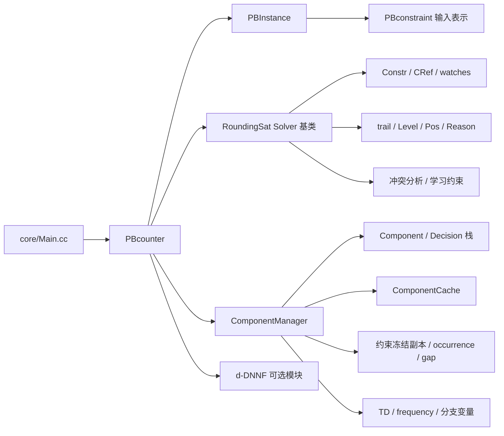

# PBMC 当前代码连接架构与递归简化接入指南

> 核对基线：当前工作区提交 `d3ef90e`。
>
> 本文只描述“当前源码实际上怎样连接和运行”，并重点回答四个问题：PBMC、GPMC、RoundingSat 之间是什么关系；新简化技术能否直接写进 `simplify()`；根预处理是否只保留规范化；VCIS 与论文中的 GPMC 启发式怎样对应。
>
> 更完整的数据结构、缓存、负文字、等式和冲突学习说明见 [PBMC_CODE.md](PBMC_CODE.md) 与 [PBMC_SIMPLIFICATION.md](PBMC_SIMPLIFICATION.md)。

## 0. 先给出四个直接结论

### 0.1 PBMC 不是单纯“在 RoundingSat 里面加了计数”

当前 PBMC 是三个系统的组合：

1. **GPMC 提供外层 top-down 模型计数框架**：显式递归状态机、组件分解、组件缓存、两分支计数组合、树分解启发式和一部分工程目录；
2. **RoundingSat 提供 PB 求解内核**：PB 约束表示、watch propagation、trail、reason、冲突分析、学习 PB 约束、回跳、activity 和 phase saving；
3. **PBMC 自己提供连接层与 PB 特化**：OPB 输入重编号、正系数化、当前 PB 根简化、VCIS、PB 组件 gap、PB 缓存键，以及把 GPMC 计数循环接到 RoundingSat 状态上。

最关键的类型关系是：

```cpp
template <class T_data>
class PBcounter : public rs::Solver {
    PBInstance<T_data> pbins;
    ComponentManager<T_data> cmpmgr;
    // ...
};
```

因此 `PBcounter` 本身既是计数器，也是一个 RoundingSat solver；它没有通过 RPC、文件或单独进程调用 RoundingSat。

### 0.2 “前端/后端”只是代码阶段，不是两个程序

本文所说的“前端”是 `PBInstance` 所在的输入与静态处理阶段；“后端”是 RoundingSat 约束库和搜索状态。二者仍在同一个 `bin/pbmc` 进程、同一个 `PBcounter` 对象里。

当前还通过一段内存 OPB 文本连接两层：

```text
原始 OPB
  -> PBInstance 解析/重编号/根简化
  -> getRenumberedOpb() 生成 stringstream
  -> RoundingSat parser 再解析一次
  -> RoundingSat Constr + watch + trail
```

这是一条“前端 IR -> 文本 -> 后端 IR”的临时边界，不是理想的长期架构。以后做大型预处理器时，最好改成统一的 canonical PB IR，或直接从预处理结果构造 RoundingSat 约束。

### 0.3 不能只往当前 `simplify()` 里写规则而不改调用链

`PBcounter::simplify()` 当前位于 `core/Counter.cc:152`，函数体只是：

```cpp
bool PBcounter<T_data>::simplify() {
    return true;
}
```

它可以被改造成“递归内简化调度器”，但当前调用点不满足目标：

- 不是每个搜索节点都会调用；
- 受 `on_simp`、`decisionLevel() <= limlevel` 和 `checkfixedDL()` 限制；
- 更关键的是，它在 `splitComponent()` 以及其中的缓存查询**之后**才调用；
- 它的原始语义来自 GPMC 的“删除已满足 CNF 子句”，不是 PB 动态简化接口；
- 当前失败分支还假定某种特殊层级关系，在一般非根节点返回 `false` 可能触发断言。

正确方向是：保留 `simplify()` 这个名字作为调度器也可以，但必须同时调整 `count_main()`，把“传播—简化”不动点放到分解和缓存之前。

### 0.4 根预处理不能只剩下“把负系数变正”

不建议把 PBMC 的根预处理全部删除，只留下正系数化。合理架构应同时保留：

- 必需的规范化/canonicalization；
- 根节点一次执行的全局、相对昂贵的 count-safe 预处理；
- 每个搜索节点执行的便宜、增量、可回溯简化；
- RoundingSat 自己的 `postProcess()`、根传播和冲突学习。

当前旧的 `PBInstance::simplifyRenumberedConstraint()` 可以在新预处理器成熟后被**替换**，但“根预处理这一层”不应被取消。GPMC 遗留的 CNF `PPMC::Preprocessor` 则是另一回事：它当前没有接入 PB 主流程，可以先不使用。

---

## 1. 源码是怎样由上游工程拼装出来的

### 1.1 setup 阶段

`setup-complete-code.sh` 固定了两个上游版本：

```text
GPMC       6eea7d6a39edbfd530f2db2cafe1993b924ea298
RoundingSat c548e1098a81d1f57dfc31560208034253d174c1
```

拼装顺序是：

```text
roundingsat-mod/ 先复制到 roundingsat/
RoundingSat 上游缺失文件再用 cp -n 补齐

pbmc-mod/ 先复制到仓库根目录
GPMC 上游缺失文件再用 cp -n 补齐
```

也就是说，`core/`、`preprocessor/`、`roundingsat/` 是当前真正编译的完整源码；`pbmc-mod/` 和 `roundingsat-mod/` 是 setup 时覆盖上游的修改层。

日常开发直接改 `core/` 或 `roundingsat/` 后运行 `make` 就会编译这些完整目录。但是，如果以后再次执行 `clean-up.sh` 和 `make setup`，没有同步回 mod 目录的改动会丢失。因此开发流程要二选一：

1. 把完整源码作为正式维护对象，不再依赖重新拼装；或
2. 每个稳定修改同时同步到 `pbmc-mod/` / `roundingsat-mod/`。

### 1.2 编译连接关系

`CMakeLists.txt` 的核心关系是：

```text
core/Main.cc
    -> executable: pbmc
    -> static library: libpbmc
         core/Counter.cc
         core/ComponentManager.cc
         core/ComponentCache.cc
         core/Instance.cc
         core/Config.cc
         preprocessor/*.cc
         ddnnf/DecisionTree.cc
         utils/*.cc
    -> libroundingsat
    -> libflowcutter
    -> zlib / MPFR / GMP / GMPXX
```

这里 `libpbmc` 是 CMake 内部静态库，不代表最终程序一定是“完全静态链接”。默认 `make` 生成的可执行文件仍会动态连接系统库；`make static` 才尝试最终静态链接。

`preprocessor/Preprocessor.cc` 和 `core/Solver.cc` 虽然仍被编译进 `libpbmc`，不代表它们参与当前 PB 主计数路径。它们主要是 GPMC/CNF 遗留代码。

---

## 2. 当前运行时对象关系



### 2.1 `PBInstance`：输入和根静态处理

主要文件：

- `core/Instance.h`
- `core/Instance.cc`
- `core/pbconstraint.h`

主要职责：

- 解析 OPB、投影变量和权重；
- 保存轻量 `PBconstraint`；
- 把投影变量重编号到前面；
- 把负系数改写成正系数与负文字；
- 执行当前有限的根简化；
- 计算 VCIS ordering score 与初始 phase；
- 重新输出内存 OPB。

`PBconstraint` 只适合输入/预处理：

```cpp
struct PBconstraint {
    vector<long> lits;    // 有符号、1-based；-3 表示 ~x3
    vector<long> coeffs;
    long rhs;
    bool equals;
    long constraintId;
};
```

它使用机器 `long`，而 RoundingSat 后端可以使用更大的整数类型。这是以后新预处理器需要统一的边界。

### 2.2 `rs::Solver`：真正的 PB 求解状态

主要文件：

- `roundingsat/Solver.hpp` / `Solver.cpp`
- `roundingsat/Constr.hpp` / `Constr.cpp`
- `roundingsat/ConstrExp.hpp` / `ConstrExp.cpp`
- `roundingsat/parsing.cpp`

关键状态：

| 字段 | 含义 |
|---|---|
| `constraints`、`ca` | 当前 solver 的紧凑 PB 约束及 allocator |
| `trail` | 当前已赋值文字，RoundingSat 文字为有符号 1-based |
| `trail_lim` | 决策层边界 |
| `Pos[v]` | 变量在 trail 中的位置，未赋值为 `INF` |
| `Level[l]` | 文字赋值所在层 |
| `Reason[v]` | 推导变量的 PB 约束引用 |
| `adj`、`qhead` | watch 列表与传播游标 |
| `activity[v]` | RoundingSat 冲突活跃度 |
| `phase[v]` | 首选文字，回溯时会 phase saving |
| `learnedStack` | 等待正规化、挂 watch 的学习约束 |

递归简化产生的赋值必须进入这套状态。只写 `PBcounter::assigns` 或只改 `PBInstance` 都不会让 watch、reason、冲突分析和回溯正确工作。

### 2.3 `ComponentManager`：计数递归、分解和缓存

主要文件：

- `core/Component.h`
- `core/ComponentManager.cc`
- `core/ComponentCache.cc`

它维护两套显式栈：

- `dl_`：`Decision<T_data>` 栈，代替 C++ 函数递归，保存两分支计数和子组件进度；
- `comp_stack_`：`Component*` 栈，保存当前待处理组件。

初始化时，`ComponentManager::init()` 会把当时 RoundingSat 中的所有约束复制到自己的 `pbca_`，建立 occurrence 列表、约束 ID、变量频率容器和 cache packing 参数。

这意味着：

> 搜索开始后，RoundingSat 新学到的约束不会自动进入 ComponentManager；原约束的结构性删除或替换也不会自动同步到 ComponentManager。

当前这种“冻结原公式、动态读取赋值和 gap”的设计对普通传播与逻辑蕴含的学习约束是可行的；对真正改变 residual formula 身份的结构简化则不够。

### 2.4 三套编号不能混用

| 层 | 编号 |
|---|---|
| OPB / `PBconstraint` | 有符号、1-based |
| RoundingSat `rs::Var` / `rs::Lit` | 有符号、1-based，0 无效 |
| ComponentManager / Glucose `Var` / `assigns` / `exscore` | 变量 0-based |

常用转换：

```text
component_var = rs_var - 1
rs_var        = component_var + 1
```

新增简化器应使用集中转换函数，不能在每条规则里随手写 `+1/-1`。

---

## 3. 从读取 OPB 到开始搜索的真实调用链

入口在 `core/Main.cc:201` 的 `main_pbmc()`：

```text
main()
  -> 构造 Configuration
  -> 构造 PBcounter<mpz_class 或 mpfr::mpreal>
  -> PBcounter::init()                         RoundingSat 初始化
  -> main_pbmc()
       -> PBcounter::load()
            -> PBInstance::load()
       -> PBInstance::renumberVar()
       -> PBInstance::makeRenumberedCoeffPositive()
       -> PBInstance::simplifyRenumberedConstraint()
       -> PBInstance::computeVarCoeffScore()
       -> PBInstance::getRenumberedOpb()
       -> PBcounter::setNbVars()
       -> copyPBInsNPVar() / copyPBInsPhase()
       -> rs::parsing::file_read()
            -> Solver::addConstraint()
            -> ConstrExp::postProcess()
            -> attachConstraint()
            -> runPropagation(true)
       -> PBcounter::setExtraVarScore()
            -> computeTDScore()
            -> addCoeffVarScore()
       -> PBcounter::countModels()
```

### 3.1 两次表示转换

前半段使用 `PBconstraint`：

```text
原始 OPB
  -> clauses
  -> renumberedClauses
  -> 正系数 renumberedClauses
  -> 根简化后的 renumberedClauses + inferredAssignment
```

随后 `getRenumberedOpb()` 把它们重新序列化，RoundingSat parser 再建立：

```text
CeSuper / ConstrExp
  -> postProcess
  -> Constr
  -> ConstraintAllocator
  -> watches
```

因此搜索开始后，不应再调用 `PBInstance::simplifyRenumberedConstraint()` 修改公式。那份对象不是 solver 当前约束库，也不知道 trail、reason、组件和缓存。

### 3.2 等式在两层中的差异

`PBInstance` 用 `equals=true` 保存一条等式。RoundingSat 的 `opb_read()` 会把它添加为两个方向的不等式。所以：

- VCIS 和前端简化看到的是一条等式对象；
- RoundingSat、TD 和 ComponentManager 看到的是两条约束；
- 以后统一 IR 时需要明确等式是在何时展开，以及约束 ID 如何映射。

---

## 4. 当前到底有哪些“预处理、规范化和简化”

这些名字在代码里容易混淆，应分成五类。

### 4.1 当前生效的 PB 根简化

函数：`PBInstance::simplifyRenumberedConstraint()`，位于 `core/Instance.cc:1051`。

当前主要做：

- 单文字约束推导固定赋值；
- 空约束判冲突或恒真；
- 把固定赋值代入其他约束；
- 删除已恒真的 `>=` 约束；
- 对二文字约束做有限 probing；
- 重复执行到局部不动点。

它不是完整的 PB 预处理器，也不是 RoundingSat 原生 inprocessing。当前代码还存在需要先用测试确认的问题，例如单文字/probing 用 `double` 比较整数关系、failed-probe 写入了不同 assignment map 等。

### 4.2 当前生效的 RoundingSat 逐约束正规化和根传播

`rs::Solver::addInputConstraint()` 会执行：

```text
ConstrExp::postProcess()
  -> 去除 root units 和零项
  -> saturation / GCD 等正规化
  -> 排序和选择紧凑约束类型
  -> attach watches
  -> runPropagation(true)
```

这部分是后端正确表示和传播的一部分，不能因为加入新预处理器就随意删除。

### 4.3 没有接入 PB 主路径的 GPMC CNF 预处理器

类型：`PPMC::Preprocessor<T_data>`，文件 `preprocessor/Preprocessor.*`。

它提供 CNF failed-literal、strengthening、等价消除、变量消除、subsumption 等，但接口接收 `GPMC::Instance<T_data>*` 和 CNF clause，不接收 `PBInstance<T_data>*`。

`PBcounter` 虽然仍有成员 `pp`，构造时也调用 `pp.setConfig()`，但是当前 `main_pbmc()` 没有调用 `pp.Simplify()`；`PBcounter::preprocess()` 也没有进入主路径。

因此不要把它误认为“PBMC 当前正在运行的预处理器”。它可以作为流程组织参考，但其 SAT/CNF 规则不能直接移植到精确 PB 模型计数。

### 4.4 当前为空的递归内 `simplify()`

`PBcounter::simplify()` 是 GPMC inprocessing 挂钩的残留。GPMC 原实现只传播并定期删除已满足 CNF clauses；PBMC 移植到 RoundingSat 后把函数体清空，但保留了调用条件。

因此它目前既不做 PB 简化，也不能证明“每层递归已经存在简化阶段”。

### 4.5 树分解不是公式预处理器

`TreeDecomposition` 和 FlowCutter 读取 primal graph，给变量计算靠近 TD centroid 的静态分数。它改变分支顺序和性能，不改变 PB 公式，也不删除变量或约束。

---

## 5. 当前计数循环的真实顺序

主循环位于 `PBcounter::count_main()`，`core/Counter.cc:394`。

当前顺序可简化为：

```text
ComponentManager::init()，冻结一份初始约束视图

while (true):
    1. 处理 unitcls
    2. RoundingSat watch propagation
    3. 若冲突：
         PB 冲突分析 -> 学习约束 -> 回跳/普通回溯
       否则：
         syncAssign()
         splitComponent()
             -> 构造剩余组件
             -> 生成 cache key
             -> 查询 cache
         -> 处理无投影变量组件，或完成/切换组件
    4. 仅在特定条件下调用空的 simplify()
    5. 清理 RoundingSat 学习库
    6. pickBranchVar()
    7. decide()
    8. 下一轮
```

最重要的顺序事实是：

```text
传播 -> 分解/缓存 -> simplify -> 选变量
```

而你希望新简化帮助“发现更多分解机会”，需要的是：

```text
传播 <-> 动态简化（到不动点） -> 分解/缓存 -> 选变量
```

如果在缓存查询后才改 residual formula，就可能出现：

- 已经按旧状态命中或创建 cache entry；
- 新简化产生的赋值没有参与本次分解；
- 已经连在一起的组件没有在本节点重新拆开；
- 结构改写没有进入 cache key，造成错误命中或重复计数。

---

## 6. 新简化技术应怎样接入递归

### 6.1 可以让 `simplify()` 做调度器，但要移动/新增调用点

推荐把 `simplify()` 改成返回结构化结果，而不是单个 `bool`：

```cpp
enum class SimplifyStatus {
    NoChange,
    StateChanged,
    Conflict
};

struct SimplifyResult {
    SimplifyStatus status;
    rs::CeSuper conflict;
    uint64_t inferred_literals;
    uint64_t derived_constraints;
    // 将来需要时再加入 count factor、undo marker、结构版本号
};
```

主循环的目标结构应接近：

```text
进入当前搜索节点/组件
  -> RoundingSat propagation
  -> 若冲突，走统一冲突分析路径
  -> 运行当前组件的便宜简化规则
  -> 若产生 reason/新约束/新赋值，再 propagation
  -> 传播与简化循环到不动点或达到预算
  -> syncAssign
  -> splitComponent + cache lookup
  -> pickBranchVar
  -> decide
```

不要保留“旧调用点再加一个新调用点”而让同一规则在一个节点执行两次；旧 GPMC 条件应该被新 inprocessing 策略明确替换。

### 6.2 第一阶段只做赋值型/蕴含型简化最安全

建议第一批递归规则只允许以下输出：

- 推导一个有合法 PB reason 的文字；
- 推导一个冲突约束；
- 添加原公式逻辑蕴含的 PB 约束；
- 记录启发式特征，但不改变公式语义。

这样可以继续保留 ComponentManager 的冻结原约束视图：

- 新赋值会通过 `syncAssign()` 影响 gap、已满足约束和分解；
- 蕴含约束不改变原公式模型集合，可以只在 solver 中帮助传播；
- 缓存仍由原约束 IDs、未赋值变量和 residual gaps 表示。

但“推导赋值”不能这样实现：

```cpp
assigns[v] = l_True;  // 错误
decide(lit);          // 也错误：它不是决策
```

它必须进入 RoundingSat 的 `trail/Level/Pos/Reason`，并让 reason 能参与 `analyzePBMC2()`。根层可以使用输入 unit 机制；非根层需要一个专门的 derived-constraint/propagation 接口，不能直接调用只允许 `decisionLevel()==0` 的 `addInputConstraint()`。

### 6.3 结构改写需要同时改 ComponentManager 和缓存

以下技术不能只修改 RoundingSat solver：

- 真正删除或替换原约束；
- 变量等价替换；
- 变量消元；
- 修改 constraint ID 或 gap 表示；
- 产生依赖当前分支的计数因子；
- 为了分解而让 ComponentManager 忽略某些尚未满足的原约束。

它们还需要：

1. 一个可回溯的 active-constraint / substitution 状态；
2. decision-level undo marker；
3. ComponentManager occurrence 图同步或按节点重建；
4. cache key 中的公式版本/规范 residual 表示；
5. 模型重构或 count ledger；
6. backjump 时跨多个层一次撤销；
7. d-DNNF、WMC、PMC 模式的额外语义处理，或先明确只支持 `mode=0`。

如果暂时只是“发现一个原约束冗余”，可以先不从 ComponentManager 删除它，正确性通常仍在，只是无法获得预期分解收益。为了真正利用结构简化，后续才升级组件视图。

### 6.4 动态简化要有预算

“每个递归都简化”不应理解为“每个节点都全量扫描所有约束直到无限不动点”。建议至少提供：

```text
inprocess_enabled
inprocess_rules
node_scan_budget
time_budget
max_fixpoint_rounds
depth_limit
min_component_size
trigger_by_new_assignments
```

规则应优先扫描当前 `topComponent()` 的相关变量和约束，而不是每次扫完整公式。

---

## 7. 根预处理与递归简化如何分工

### 7.1 不应只保留一种

推荐的长期管线是：

```text
解析
  -> 精确 canonicalization
  -> 根全局 count-safe 预处理
  -> 变量映射/计数 ledger 定稿
  -> 在最终公式上计算 VCIS/TD
  -> 构造 RoundingSat 与 ComponentManager
  -> 搜索节点内增量简化
```

根预处理适合：

- 合并重复项与同约束中的 `x/~x`；
- 精确处理负系数、零项、GCD、恒真/冲突；
- 全局重复约束、包含/支配关系；
- 全局 probing；
- 等价变量识别和可证明 count-safe 的替换；
- 一次性重编号与模型重构映射；
- 在构造缓存和 TD 前减少公式规模。

递归内简化适合：

- 当前赋值下的 unit/failed literal；
- 当前 residual gap 下才出现的支配或蕴含；
- 局部约束组合；
- 便宜的局部等价检测；
- 产生新赋值后触发新的分解。

### 7.2 哪些旧东西保留、替换或不用

| 当前模块 | 建议 |
|---|---|
| 正负系数、文字、重复项等 canonicalization | 必须保留并加强，改成任意精度精确实现 |
| RoundingSat `postProcess()` 与 watch/root propagation | 保留，它是后端约束合法化与传播基础 |
| `PBInstance::simplifyRenumberedConstraint()` | 新预处理器成熟前保留为独立开关；之后由新根预处理器逐条覆盖和替换 |
| `PPMC::Preprocessor` | 当前不适用于 PB 主路径；可暂留作参考，后续确认无依赖后再清理 |
| 空的 `PBcounter::simplify()` | 重设计成动态简化调度器，并调整主循环调用点 |
| TD/FlowCutter | 作为启发式独立保留，不属于语义简化 |

### 7.3 为什么不能只留“正系数化”

正系数化只完成：

```text
-a*l  ->  a*~l，并同步调整 RHS
```

它没有解决：

- 同变量重复项；
- 一个约束内同时出现 `x` 与 `~x`；
- 零项与 GCD；
- 恒真/冲突；
- 等式展开语义；
- 根 unit 与 probing；
- 自由变量和模型重构；
- 变量映射与计数因子。

这些不变量不先建立，递归简化的每条规则都会被迫自己处理脏输入，既容易错，也无法形成统一缓存表示。

---

## 8. VCIS 与 GPMC 启发式的准确关系

### 8.1 论文确实做了两种启发式对比

论文第 4.3 节比较：

| 配置 | Auction | M-dim knapsack | Sensor | 总计 |
|---|---:|---:|---:|---:|
| GPMC-heu | 541 | 587 | 644 | 1772 |
| VCIS-heu | 503 | 702 | 644 | 1849 |

论文的描述不是“完全删除 GPMC 启发式，改用单独 VCIS”，而是：

> 把 coefficient impact score 作为一个等权附加分量，加入从 GPMC 继承的变量决策启发式。

所以 VCIS-heu 是在 GPMC 框架上增加 PB 系数信息。

### 8.2 GPMC 遗留启发式由什么组成

当前 `ComponentManager::pickBranchVar()` 基本保留了上游 GPMC 的选择结构：

- 全局静态 `exscore`，原本主要来自树分解；
- 当前 residual component 的动态 `var_frequency_`；
- 冲突 activity 作为 tie-break 或强覆盖条件；
- 分支 phase 决定先走正文字还是负文字。

PBMC 将 Glucose activity 换成了 RoundingSat activity，并把 VCIS 混入 `exscore`。

### 8.3 当前 VCIS 怎样计算和接入

论文公式是：

```text
                 1              b_x^j
VCIS(x) = -------------  ×  Σ  -------
           |Omega_x|      j      k_j
```

当前 `PBInstance::computeVarCoeffScore()` 对每次出现计算：

```cpp
impact = min(1.0, abs(coef) / abs(rhs));
```

然后归一化到 `[0, coef_tdscore]`。`addCoeffVarScore()` 最终做：

```cpp
exscore[i] = (td_score[i] + vcis_score[i]) / 2;
```

初始 phase 则选择该变量单次 impact 最大的文字方向；之后 RoundingSat 回溯会做 phase saving。

当前实现有一个重要审计点：平均值分母写成了所有变量数 `varCoeffScoreVec.size()`，而论文公式应是当前变量的出现次数 `varCoeffScoreVec[i].size()`。全局归一化后，现实现更接近“impact 求和排序”，会偏向出现次数多的变量。开始做新启发式前应先用单元测试确认并修复或明确保留该行为。

### 8.4 `-vs=0/1` 不是 VCIS/GPMC 开关

`core/Config.cc` 中默认 `-vs=1`。它选择的是 `pickBranchVar()` 内的两种组合方式：

`-vs=1`：

```text
exscore 最大
  -> frequency 最大
  -> RoundingSat activity 最大
```

`-vs=0`：

```text
frequency + exscore 为主分数
如果候选达到最佳主分数的 90%，且 activity 大于 1.5 倍，也可替换
```

这两个分支在原 GPMC 中已经存在。它们不是：

```text
vs=0 = GPMC-heu
vs=1 = VCIS-heu
```

### 8.5 当前命令行不能干净复现论文的 GPMC-heu 消融

当前 `setExtraVarScore()` 是：

```cpp
if (varscore_file) {
    setGivenVarScore();
} else if (doTD) {
    computeTDScore();
    addCoeffVarScore();
}
```

因此：

- 默认 `-td`：计算 TD，并把 VCIS ordering 混入 `exscore`；
- `-no-td`：TD 和 VCIS ordering 都不加入；
- 但 `computeVarCoeffScore()` 和 `copyPBInsPhase()` 更早无条件执行，所以 `-no-td` 仍保留 VCIS 初始 phase；
- `-varscore=file` 会替换 TD/VCIS ordering，但同样仍保留 VCIS phase；
- `-coef=0` 同时把 TD 和 VCIS 的缩放压到 0，也不是“只关 VCIS”。

所以仅靠现有公开参数无法得到“保留 GPMC TD/frequency/activity/phase 策略，只关闭 VCIS ordering 和 VCIS phase”的严格基线。

### 8.6 后续应拆成独立开关

建议先把启发式实验接口拆开：

```text
use_td_score
use_vcis_ordering
use_vcis_initial_phase
use_phase_saving
variable_score_combiner = lexicographic | additive
use_activity
use_component_frequency
```

然后定义两个可复现实验配置：

```text
GPMC_HEU:
  TD + component frequency + activity
  VCIS ordering off
  VCIS initial phase off

VCIS_HEU:
  equal-weight(TD, VCIS) + component frequency + activity
  VCIS initial phase on
```

这样以后加入你的新启发式，才能分别报告：只换 ordering、只换 phase、加入预处理特征，以及组合策略的消融结果。

---

## 9. 文件级职责地图

| 文件/目录 | 当前真实职责 | 修改简化技术时的关系 |
|---|---|---|
| `core/Main.cc` | 单进程入口；组织前端处理、RoundingSat 建库、启发式和计数 | 新根预处理器的总调度位置 |
| `core/Config.*` | PBMC/GPMC 参数 | 新根预处理、inprocessing、VCIS 独立开关 |
| `core/Instance.*` | OPB 前端、重编号、当前根简化、VCIS/phase | 新根预处理 IR 与特征计算 |
| `core/pbconstraint.h` | 轻量 PB 输入结构 | 需要任意精度和 canonical form |
| `core/Counter.*` | `PBcounter : rs::Solver`；计数状态机、冲突/回跳、分支 | 动态简化调度与统一冲突出口 |
| `core/Component.h` | Decision、Component、packed cache 类型、ComponentManager 声明 | undo marker、公式版本和 cache 扩展 |
| `core/ComponentManager.cc` | 分解 residual graph、计算 gap/frequency、查询 cache、选变量 | 结构简化同步、动态启发式 |
| `core/ComponentCache.cc` | cache 哈希、存取、淘汰和统计 | 新 key/载荷/版本语义 |
| `roundingsat/Solver.*` | trail、watch propagation、reason、学习、回跳、activity/phase | 非根 derived constraint 与 reason 接口 |
| `roundingsat/Constr*` | PB 紧凑表示、展开表示、slack、resolve、正规化 | 实现 PB 级规则和冲突证明的基础 |
| `roundingsat/parsing.cpp` | 第二次解析内存 OPB；等式展开 | 统一 IR 后可消除的文本边界 |
| `preprocessor/Preprocessor.*` | GPMC CNF 预处理器，当前未接 PB 主路径 | 只参考组织方式，不直接复用规则 |
| `preprocessor/TreeDecomposition.*` | primal graph、TD centroid score | 静态启发式，不是语义预处理 |
| `preprocessor/IFlowCutter.*`、`flow-cutter-pace17/` | TD 第三方实现与封装 | 通常不改 |
| `ddnnf/` | 可选 d-DNNF 构造 | 结构简化时要维护证明/节点语义 |
| `core/Solver.*` | GPMC/Glucose 遗留 SAT solver | PB 主搜索不继承它，主要服务遗留 CNF 代码 |
| `pbmc-mod/`、`roundingsat-mod/` | setup 覆盖层 | 稳定修改若仍需 setup，必须同步 |

---

## 10. 建议的实现顺序

### 阶段 A：只重构接口，不加真实规则

1. 给根预处理、TD、VCIS ordering、VCIS phase、动态简化分别增加独立开关；
2. 把 `simplify()` 改成结构化返回值；
3. 在 `count_main()` 中建立“传播—简化不动点—分解/缓存”的唯一入口；
4. 增加每节点/每规则统计与预算；
5. 用现有 benchmark 验证关闭所有新规则时模型数和原程序一致。

### 阶段 B：加入只产生赋值/冲突的规则

1. 设计合法 reason 的提交接口；
2. 先做一条容易暴力验证的规则；
3. 每次推导后重新传播；
4. 用小规模枚举器逐实例比较模型数；
5. 检查回溯、非顺序回跳、缓存命中和两种文字极性。

### 阶段 C：形成新的根预处理器

把已经证明 count-safe、无需依赖搜索层的规则移到统一根预处理器；在最终公式上重新生成：

- 变量映射；
- 固定变量与自由变量 ledger；
- RoundingSat 约束；
- ComponentManager occurrence/cache packing；
- VCIS、TD 和初始 phase。

### 阶段 D：最后再做结构简化和缓存升级

等价替换、变量消元和动态约束删除需要先完成可回溯公式视图、模型重构和 cache identity 设计。不要把它们与第一批赋值型规则一起实现，否则很难定位计数错误来自规则本身、undo 还是缓存。

---

## 11. 开始修改前的最小检查表

- [ ] 新规则保持完整模型集合，还是只有 SAT 等可满足？
- [ ] 负文字、负系数、等式和重复项的语义是否覆盖？
- [ ] 推导文字是否有 RoundingSat reason，而不是伪装成 decision？
- [ ] 规则发生在 cache lookup 之前吗？
- [ ] 只产生赋值，还是改变原约束/变量身份？
- [ ] ComponentManager 的冻结副本是否仍然足够？
- [ ] 回溯和 backjump 要撤销哪些状态？
- [ ] 是否存在 count factor，缓存值中乘入一次还是多次？
- [ ] VCIS/TD 是在最终根公式上计算的吗？
- [ ] `-vs`、TD、VCIS ordering 和 phase 是否能独立消融？
- [ ] 是否用暴力枚举验证了正/负文字、等式、两分支和 cache hit？

## 12. 最简学习路线

按下面顺序读代码最容易建立整体认识：

```text
1. core/Main.cc::main_pbmc
2. core/Instance.cc::load / renumberVar / makeRenumberedCoeffPositive
3. core/Instance.cc::simplifyRenumberedConstraint / computeVarCoeffScore
4. roundingsat/parsing.cpp::opb_read
5. roundingsat/Solver.cpp::addInputConstraint / attachConstraint / runPropagation
6. core/Counter.cc::countModels / count_main
7. core/ComponentManager.cc::init / splitComponent / searchComponent
8. core/ComponentCache.cc 与 core/Component.h 的 packed key
9. core/Counter.cc::analyzePBMC2 / ResolveWithoutLit / backtrack
10. core/ComponentManager.cc::pickBranchVar 与 Counter.cc::setExtraVarScore
```

读完第 1～6 步，就能理解“PBMC 怎样把 RoundingSat 放进 GPMC 计数框架”；读完第 7～9 步，才适合开始改递归简化和缓存；最后再改 VCIS 和你的新启发式。
